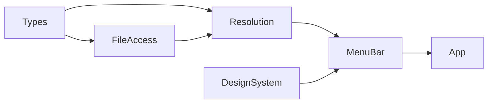
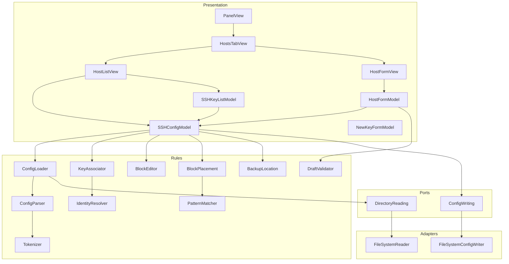
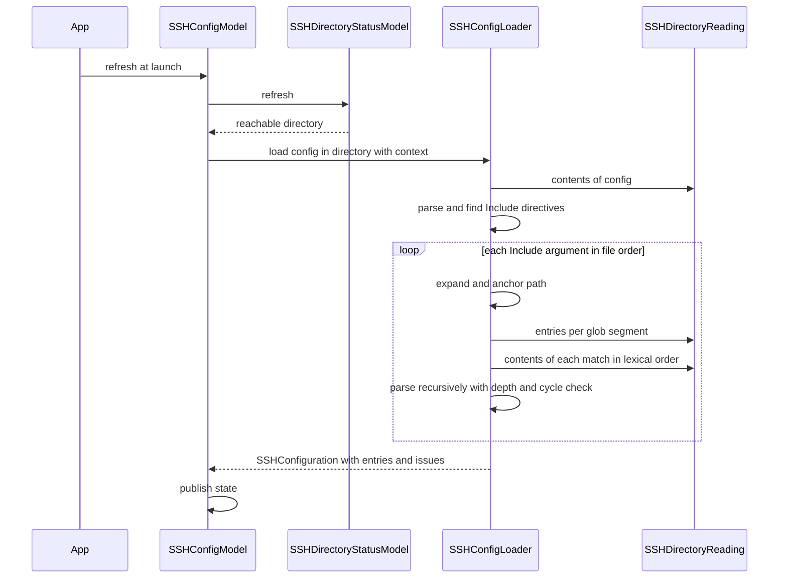
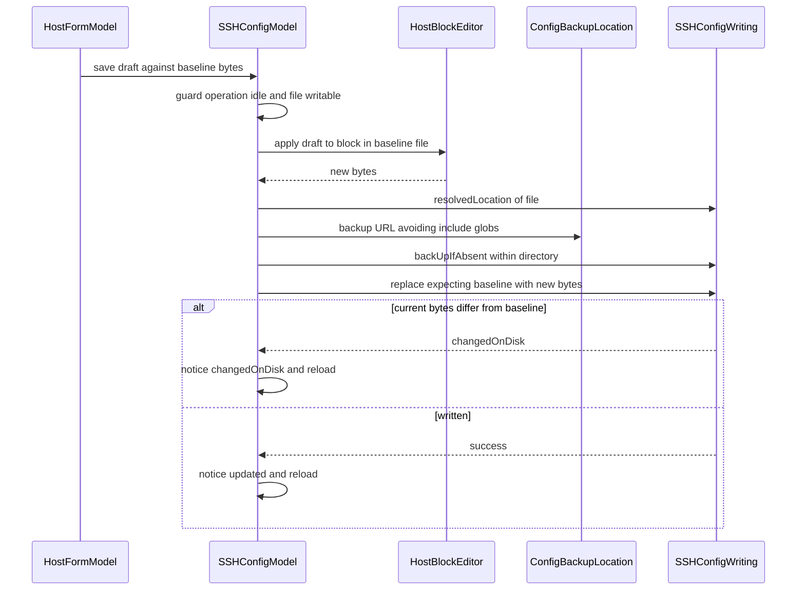
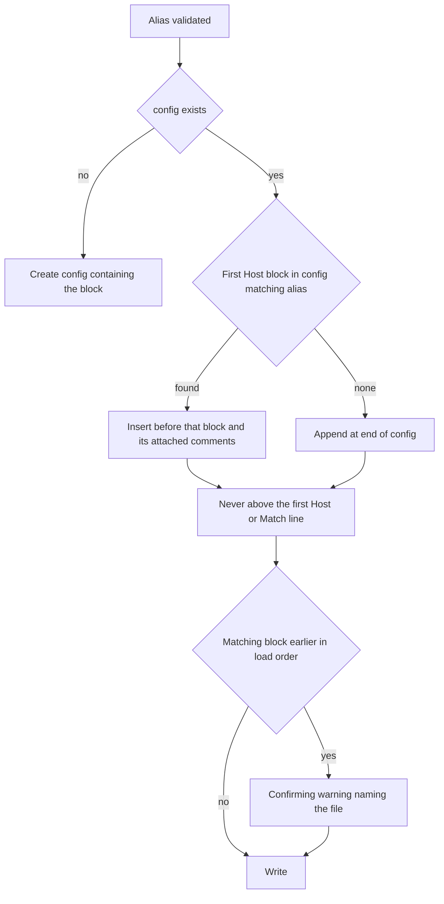

# Technical Design — crud-ssh-config-hosts

## Overview

**Purpose**: This feature adds open-ssh-gui's host surface. The app reads `~/.ssh/config` and every file it `Include`s, lists the `Host` entries with the key each one uses, flags a key shared between hosts, and lets the user edit, create and delete entries. It also reorganises the panel into three tabs: **Keys**, **Hosts** and **New Key**.

**Users**: A developer opens the panel to see which machines are configured and with which identity, fixes a host name or port without opening an editor, adds a host for a new machine and picks one of the keys that already exist, and notices a key reused across hosts.

**Impact**: This is the first feature to write `~/.ssh/config`. It adds a **separate, narrow write port** for configuration files, so the key port stays unable to create files and the read port stays read-only. All config text handling uses a **lossless line model**, which makes byte-for-byte preservation hold by construction rather than by care. The panel's two-route navigation (`PanelRoute`) becomes a tab bar, the panel grows by the tab bar's height, and `crud-ssh-keys` Requirement 6.4 becomes live.

### Goals

- Load the whole configuration at launch, following `Include` exactly as `ssh` does, and attribute every host to its file and line.
- Edit, create and delete host blocks while leaving every byte outside the affected block unchanged, writing atomically, backing up first and never overwriting an external edit.
- Associate `IdentityFile` values with the key pairs `crud-ssh-keys` discovers, and warn about sharing, without ever guessing at an unresolvable value.
- Keep `MenuBarExtra` the only scene and the panel one fixed size, now with a tab bar.

### Non-Goals

- Computing a host's effective configuration (`ssh -G`), or showing inherited values.
- Presenting or editing `Match` blocks; editing any directive other than `Host`, `HostName`, `User`, `Port` and `IdentityFile`; adding, removing or editing `Include` directives.
- Writing outside the resolved SSH directory, including through a symbolic link that points outside it.
- Rewriting `IdentityFile` references when a key is renamed or deleted; adding `IdentitiesOnly` or any other directive.
- Watching files for changes while the panel is idle; reordering blocks; any undo beyond the one-time backup.

## Boundary Commitments

### This Spec Owns

- **Configuration loading**: reading `config`, expanding and following `Include`, cycle and depth handling, and recording load issues.
- The **lossless configuration model** (`SSHConfigFile`, its lines, blocks and spans) and the **tokenizer** that defines how this app reads a line.
- **Host pattern matching**, **`IdentityFile` resolution**, **host–key association** and **shared-key detection**.
- **Host value validation**, **block editing** (edit, insert, remove), **new-block placement** and **value formatting**.
- The **`SSHConfigWriting` port**, its adapter and its atomic-write, backup, symlink, permission and concurrent-modification semantics.
- The **panel tab model** (`PanelTab`), which replaces `PanelRoute`, and the Hosts tab's surfaces.
- The `HostReferenceLookup` contract that key management consumes for Requirement 11.

### Out of Boundary

- `SSHDirectoryReading` and `SSHDirectoryResolver`, consumed unchanged. **The read port is not widened.**
- `SSHKeyWriting`, which keeps move and remove only. **The key port does not gain create or write.**
- Key discovery, key metadata and the New Key form's fields and rules, all owned by `crud-ssh-keys`. This spec moves the form behind a tab and adds one discard entry point.
- Component appearance, owned by the Design System layer. This spec adds one generic composite (`TabBar`) and new `PanelMetrics` tokens to that layer, and names no OpenSSH concept in it.
- What `ssh` does at connection time: canonicalisation, `Match` evaluation, `/etc/ssh/ssh_config`.

### Allowed Dependencies

- `SSHDirectoryReading` for every read, including glob expansion. `SSHDirectory` and `SSHDirectoryStatusModel` for the resolved directory.
- `SSHKeyListModel.state` (read-only) for the key pairs used in association and in the picker.
- Design System components: `BoundedList`, `LabeledField`, `StatusIndicator`, `SectionHeader`, `EmptyState`, `ConfirmingButtonStyle`, `StatusRole`, `ColorRoleAppearance`, tokens.
- Apple SDK frameworks only. Foundation (and Darwin for `renamex_np`) inside `FileAccess/` only.
- **Constraint**: nothing outside `FileAccess/` imports `FileManager` or calls a file-system API; nothing outside `OpenSSHGUIApp` constructs an adapter; no view reaches a port.

### Revalidation Triggers

- A change to `SSHConfigWriting`'s contract, or to `SSHConfigFile`'s line and span model.
- A change to key discovery's notion of a pair (`SSHKeyPairLocation`), which association matches against.
- A change to `PanelTab`, `PanelMetrics.height` or `PanelMetrics.surfaceHeight`, which every surface depends on.
- A change to `NewKeyFormModel`'s completion semantics, which tab adoption relies on.
- An OpenSSH release that changes tokenisation, `Include` anchoring, the depth limit or pattern matching.

## Architecture

### Existing Architecture Analysis

The app is layered (`Types → FileAccess/Platform → Resolution → MenuBar → App`, with `DesignSystem` as a second root). It has one composition root, injected ports with no default values, `nonisolated` adapters with `@concurrent` methods, typed throws with user-facing `reason`s, closed state enums and a panel whose every region has a fixed height. This design keeps all of these. Specific integration points:

- `PanelView` owns a `PanelRoute` (`keyList | newKey`) and adopts `NewKeyFormModel.completion`. It becomes the owner of a `PanelTab` instead.
- `SSHKeyListView` refreshes in its own `.task` and shows a "New key" button. The refresh moves to the panel and the button is removed (10.6).
- `NewKeyFormModel.cancel()` produces a `.cancelled` completion. Leaving the tab must not do that (see `NewKeyFormModel` below).
- `PanelMetrics.height` has about 23 points of deliberate slack, which cannot hold a tab bar, so the height grows.

### Architecture Pattern & Boundary Map

**Selected pattern**: layered ports and adapters, extended without a new layer. Pure configuration rules join `Resolution/`, the loader joins `Resolution/` as the resolver did (it depends on the read port, never on an adapter), the new port and adapter join `FileAccess/`, and models and views join `MenuBar/`.





**Architecture Integration**:

- **Domain boundaries**: pure rules know nothing of ports or models. `SSHConfigModel` owns the loaded configuration, the mutations and their in-flight state. `HostFormModel` owns only draft state. Views own nothing.
- **Keys ↔ hosts without a cycle**: `SSHConfigModel` depends on nothing key-related. `SSHKeyListModel` depends on the `HostReferenceLookup` protocol, which `SSHConfigModel` conforms to. Host presentation reads both models. The composition root constructs configuration first.
- **Existing patterns preserved**: single composition root; no defaulted injections; typed throws; closed operation enums (`ConfigOperation` mirrors `KeyOperation`); projections on values; fixed-height regions.
- **New components rationale**: one port because writing configuration is a distinct capability from moving keys; a tokenizer separate from the parser because quoting is where a misread would rewrite the wrong text; pure placement and editing so every preservation rule is testable from strings.
- **Steering compliance**: `SSHDirectoryReading` and `SSHKeyWriting` untouched; `FileManager` stays in `FileAccess/`; the new adapter is `nonisolated` with `@concurrent` methods; no third-party dependency.

**Decision worth stating**: **the app never serialises a configuration from a model.** Every write is the original bytes with specific line ranges replaced, inserted or removed. There is no "render file" function to get wrong.

### Technology Stack

| Layer | Choice / Version | Role in Feature | Notes |
|-------|------------------|-----------------|-------|
| UI | SwiftUI, `MenuBarExtra` only scene | Tab bar, host list, host form | Segmented control, not `TabView`; fixed heights |
| UI appearance | Design System layer (this project) | Every control | Adds `TabBar` and tokens |
| Rules | Swift 6.4 toolchain, language mode 5 | Parsing, matching, resolution, validation, editing | Pure; typed throws; byte-level line splitting |
| File reading | Existing `SSHDirectoryReading` | Config, includes, glob listing | Unchanged |
| File writing | Foundation `FileManager` + Darwin `renamex_np`, `fchmod` | Atomic replace, exclusive create, backup | Inside `FileAccess/` only |
| Testing | Swift Testing | Pure rules directly; models through fakes; adapter against a scratch directory | No host application |

No new framework dependencies. Darwin is already implicitly available through Foundation.

### Design System Components Consumed

| Surface in this feature | Design System element |
|---|---|
| Tab bar | **New** `TabBar` composite (generic, segmented `Picker`) |
| Host list, key picker | `BoundedList`, row chrome |
| "No hosts" / "No configuration file" | `EmptyState` |
| Shared-key warning, load issues, notices | `StatusIndicator` with `StatusRole.warning` / `.failure` / `.success` |
| Row warning icon | `StatusRole.warning.symbolName` tinted via `ColorRoleAppearance` (amber/orange `Warning` colour set) |
| Host fields | `LabeledField` with `FieldValidation` |
| Host attributes in the detail region | `LabeledContentStyle` (`.panel`) |
| Delete confirmation, placement warning | `ConfirmingButtonStyle` with caller-supplied title and message |
| Section headings | `SectionHeader` |

## File Structure Plan

### Directory Structure

```
open-ssh-gui/
├── Types/
│   ├── SSHConfiguration.swift          # Loaded files in load order + entries + issues
│   ├── SSHConfigFile.swift             # One file: URL, raw lines, line ending, writability, include chain
│   ├── SSHConfigLine.swift             # Raw text + terminator + kind (blank|comment|directive|malformed)
│   ├── SSHConfigDirective.swift        # Keyword + arguments + spans (indent, keyword, separator, value, comment)
│   ├── SSHConfigKeyword.swift          # Case-insensitive keyword value with named constants
│   ├── HostEntry.swift                 # One Host block: id, file, line range, patterns, declared values
│   ├── HostEntryID.swift               # File URL + block ordinal within the file
│   ├── HostPattern.swift               # Text + negated + hasWildcard
│   ├── IdentityReference.swift         # raw value + resolution (path | none | unresolvable(reason))
│   ├── HostKeyAssociation.swift        # Per entry: [IdentityReference -> listed key | unlisted | unresolved]
│   ├── HostKeyIndex.swift              # Associations + shared-key groups, queryable by entry and by key
│   ├── HostDraft.swift                 # Form values: patterns, hostName, user, port, keyChoice
│   ├── HostKeyChoice.swift             # unchanged | none | pair(SSHKeyName)
│   ├── HostDraftError.swift            # Per-field rejection reasons
│   ├── ConfigLoadIssue.swift           # unparseableLine | unreadable | skippedInclude | depthExceeded | cycle
│   ├── ConfigWritability.swift         # writable | readOnly(ConfigReadOnlyReason)
│   ├── IdentityResolutionContext.swift # home, ssh directory, user name, isDefaultDirectory
│   └── SSHConfigWriteError.swift
├── FileAccess/
│   ├── SSHConfigWriting.swift          # Port: resolvedLocation, backUpIfAbsent, replace(expecting:), create
│   └── FileSystemSSHConfigWriter.swift
├── Resolution/
│   ├── SSHConfigTokenizer.swift        # OpenSSH argv_split semantics, with spans; pure
│   ├── SSHConfigParser.swift           # Data -> SSHConfigFile (lossless); pure
│   ├── SSHConfigLoader.swift           # Reads config + includes through the read port
│   ├── IncludePathExpander.swift       # Include argument -> glob segments, anchored; pure
│   ├── GlobPattern.swift               # glob(3)-compatible segment matching, leading-dot rule; pure
│   ├── SSHHostPatternMatcher.swift     # ssh pattern-list semantics; pure
│   ├── IdentityFileResolver.swift      # IdentityFile argument -> resolution; pure
│   ├── HostKeyAssociator.swift         # (configuration, pairs, context) -> HostKeyIndex; pure
│   ├── HostDraftValidator.swift        # Draft -> validated draft | per-field errors; pure
│   ├── SSHConfigValueFormatter.swift   # Value -> argument text with OpenSSH-compatible quoting; pure
│   ├── HostBlockEditor.swift           # Edit/insert/remove a block in an SSHConfigFile -> Data; pure
│   ├── HostBlockPlacement.swift        # Insertion point + preceding-match warning; pure
│   └── ConfigBackupLocation.swift      # Backup URL for a file, checked against include globs; pure
├── DesignSystem/
│   └── Components/TabBar.swift         # Generic segmented tab bar; names no OpenSSH concept
└── MenuBar/
    ├── PanelTab.swift                  # Closed: keys | hosts | newKey (replaces PanelRoute)
    ├── SSHConfigModel.swift            # @MainActor @Observable; load, index, mutate, notices
    ├── SSHConfigState.swift            # Closed: loading | loaded | noConfigFile | noDirectory | unreadable
    ├── ConfigOperation.swift           # Closed: idle | creating | updating(id) | deleting(id)
    ├── ConfigNotice.swift              # created | updated | deleted | failed | changedOnDisk
    ├── HostReferenceLookup.swift       # Protocol consumed by SSHKeyListModel
    ├── HostFormModel.swift             # @MainActor @Observable; mode, draft, validation, baseline
    ├── HostEntryPresentation.swift     # Row/detail projections (title, summary, key text, warning)
    ├── HostsTabView.swift              # List or form, by HostFormModel.mode
    ├── HostListView.swift
    ├── HostRowView.swift
    ├── HostFormView.swift
    └── HostKeyChoiceRowView.swift

open-ssh-guiTests/Support/
├── InMemorySSHConfigWriter.swift       # Holds file contents; can simulate external change or failure
└── StaticHostReferenceLookup.swift     # Fixed reports for SSHKeyListModel tests
```

Test files follow the one-test-file-per-production-type convention and are not listed. A shared fixture corpus of configuration texts (CRLF, tabs, `=` separators, quotes, trailing comments, unknown keywords, `Match`, nested includes) lives in one test support file used by the parser, editor and round-trip suites.

### Modified Files

- `open-ssh-gui/OpenSSHGUIApp.swift` — constructs `FileSystemSSHConfigWriter`, `SSHConfigModel` (before `SSHKeyListModel`) and `HostFormModel`. Injects the user name for `%u`. Starts the launch-time configuration load (1.1). Still the only place that constructs an adapter.
- `open-ssh-gui/MenuBar/PanelView.swift` — owns `PanelTab` and the `TabBar`. Refreshes both models on each panel open (1.11). Discards forms on tab change (10.9). Adopts key-generation completion by selecting Keys (10.7). Notice region shows the active tab's notice.
- `open-ssh-gui/MenuBar/PanelRoute.swift` — **deleted**, replaced by `PanelTab`.
- `open-ssh-gui/MenuBar/SSHKeyListView.swift` — the "New key" button and the `onCreate` callback are removed (10.6). The `.task` refresh moves to `PanelView`.
- `open-ssh-gui/MenuBar/SSHKeyListModel.swift` — gains a `HostReferenceLookup` dependency (no default). The rename warning and the deletion message name the referencing hosts (11.1–11.4).
- `open-ssh-gui/MenuBar/NewKeyFormModel.swift` — gains `discard()`, which clears values and secrets without producing a completion, and is a no-op while generating (10.8, 10.9).
- `open-ssh-gui/DesignSystem/Tokens/PanelMetrics.swift` — adds `tabBarHeight`, `hostListHeight`, `hostDetailHeight` and `keyPickerHeight`; `height` grows by `tabBarHeight + Spacing.regular`.
- `open-ssh-guiTests/SSHKeyListModelTests.swift`, `PanelSizingTests.swift` — updated for the new initializer and metrics.

## System Flows

### Loading the configuration



- An `Include` argument containing `${…}`, `~user`, or a token other than `%d`, `%u` and `%%` is reported as `skippedInclude(.unresolvable)` and not followed.
- When the resolved directory is not the default one, a resolved include path outside it is reported as `skippedInclude(.outsideOverride)` and never read (1.10).
- A missing file is skipped silently (1.6). Any other read failure becomes `unreadable(file, FileAccessError)`, and loading continues with the next match (1.9).
- Depth greater than 16, or a canonical path already on the current include chain, stops that branch with an issue naming the file (1.7). Everything loaded so far is kept.
- Each included file records its **inclusion chain**: the patterns of every enclosing `Host` block, or "under a Match block". Placement uses the chain (6.10) and the list uses it to show attribution.

### Writing an edit



- The **baseline** is the file's bytes when the form opened. A panel refresh while the form is open does not move the baseline, so an external edit made in between is always detected (9.6).
- A backup failure aborts the write; nothing has been changed (9.7). A replace failure after a successful backup leaves the original untouched and the backup in place, which is harmless.
- Deletion follows the same path with `HostBlockEditor.remove`. Creation uses `HostBlockPlacement` then `HostBlockEditor.insert`, or `create` when `config` does not exist (6.12), in which case no backup is taken.

### New-block placement



- Matching uses `SSHHostPatternMatcher` with OpenSSH semantics: the lowercased alias, `*` and `?` globbing, and a negation veto (6.6). `Match` blocks are skipped (6.9).
- "Earlier in load order" means a `Host` block that matches the alias and lies before the chosen insertion point in the flattened load order, in a different file reached through an `Include` in the global section or in an earlier block whose inclusion chain also matches the alias. A chain that passes through a `Match` block counts as possibly matching (6.10).
- The warning reuses `ConfirmingButtonStyle`. The user can proceed, and declining writes nothing.

## Requirements Traceability

| Requirement | Summary | Components | Interfaces | Flows |
|-------------|---------|------------|------------|-------|
| 1.1, 1.11, 1.12, 1.13 | Load at launch, on panel open, after mutations, off main | `OpenSSHGUIApp`, `PanelView`, `SSHConfigModel`, `SSHConfigLoader` | `SSHConfigModel.refresh()` | Loading |
| 1.2–1.7 | Include following, anchoring, globs, nesting, missing, cycles | `SSHConfigLoader`, `IncludePathExpander`, `GlobPattern` | `SSHConfigLoader.load` | Loading |
| 1.8, 1.9 | No config vs unreadable | `SSHConfigState`, `ConfigLoadIssue` | — | Loading |
| 1.10, 9.10 | Override confinement | `IdentityResolutionContext`, `SSHConfigLoader`, `FileSystemSSHConfigWriter` | `isDefaultDirectory` | Loading |
| 2.1, 2.2, 2.8, 2.9, 2.11, 2.13 | Entries in file order, declared values only, attribution, no Match, bounded list | `SSHConfigParser`, `HostEntry`, `HostListView`, `HostEntryPresentation` | `SSHConfiguration.entries` | — |
| 2.3–2.7 | Key per IdentityFile; listed, unlisted, unresolved, default | `IdentityFileResolver`, `HostKeyAssociator` | `HostKeyIndex` | — |
| 2.10 | Pattern entries | `HostPattern`, `HostEntry.isPatternEntry` | — | — |
| 2.12 | Unparseable lines | `SSHConfigParser`, `ConfigLoadIssue.unparseableLine` | — | Loading |
| 3.1–3.8 | Shared-key warning | `HostKeyAssociator`, `HostKeyIndex`, `HostRowView`, `HostListView` | `HostKeyIndex.sharingHosts` | — |
| 4.1–4.6 | Key picker with warnings | `HostFormModel`, `HostFormView`, `HostKeyChoiceRowView` | `HostFormModel.keyChoices` | — |
| 4.7, 4.8 | IdentityFile value written | `SSHConfigValueFormatter`, `HostBlockEditor` | `identityFileArgument(for:)` | — |
| 5.1–5.10 | Edit | `HostFormModel`, `HostBlockEditor`, `SSHConfigModel` | `SSHConfigModel.update` | Writing an edit |
| 6.1–6.4, 6.11, 6.14, 6.15 | Create form | `HostFormModel`, `HostFormView` | `HostFormModel.beginCreate` | — |
| 6.5–6.10 | Placement | `HostBlockPlacement`, `SSHHostPatternMatcher` | `HostBlockPlacement.place` | Placement |
| 6.12, 6.13 | No config, no directory | `SSHConfigModel`, `SSHConfigWriting.create` | `create(_:with:within:)` | Placement |
| 7.1–7.9 | Validation | `HostDraftValidator`, `HostFormModel` | `HostDraftValidator.validate` | — |
| 8.1–8.7 | Delete | `HostListView`, `SSHConfigModel`, `HostBlockEditor.remove` | `SSHConfigModel.delete` | Writing an edit |
| 9.1, 9.2 | Byte preservation, line endings | `SSHConfigFile`, `HostBlockEditor` | — | — |
| 9.3–9.7 | Atomic, backup, permissions, concurrent change, failure | `SSHConfigWriting`, `FileSystemSSHConfigWriter`, `ConfigBackupLocation` | `replace`, `backUpIfAbsent` | Writing an edit |
| 9.8, 9.9, 9.12, 9.14 | Write scope | `SSHConfigModel`, `FileSystemSSHConfigWriter` | `within:` parameter | — |
| 9.11, 9.13 | Off main, one at a time | `FileSystemSSHConfigWriter`, `ConfigOperation` | — | — |
| 10.1–10.14 | Tabs | `PanelTab`, `PanelView`, `TabBar`, `NewKeyFormModel.discard`, `PanelMetrics` | — | — |
| 11.1–11.5 | Key cross-references | `HostReferenceLookup`, `SSHConfigModel`, `SSHKeyListModel` | `hostReferences(to:)` | — |
| 12.1–12.8 | Design system and accessibility | All host views, `TabBar` | — | — |
| 13.1–13.7 | Testability | Pure rules, `InMemorySSHConfigWriter`, `StaticHostReferenceLookup` | — | — |

## Components and Interfaces

| Component | Layer | Intent | Req Coverage | Key Dependencies | Contracts |
|-----------|-------|--------|--------------|------------------|-----------|
| SSHConfigTokenizer | Resolution | Split a line exactly as OpenSSH does, with spans | 2.12, 9.1 | — | Service |
| SSHConfigParser | Resolution | Bytes → lossless `SSHConfigFile` | 2.1, 2.2, 2.11, 2.12, 9.1, 9.2 | Tokenizer (P0) | Service |
| SSHConfigLoader | Resolution | Read config and includes into `SSHConfiguration` | 1.1–1.10 | Reader (P0), Parser (P0), IncludePathExpander (P0) | Service |
| IncludePathExpander, GlobPattern | Resolution | Anchor, expand and match include paths | 1.3, 1.4, 1.10 | — | Service |
| SSHHostPatternMatcher | Resolution | OpenSSH host pattern-list semantics | 2.10, 3.3, 6.6, 6.10, 7.3 | — | Service |
| IdentityFileResolver | Resolution | `IdentityFile` argument → path or reason | 2.4–2.6, 3.2, 11.4 | — | Service |
| HostKeyAssociator | Resolution | Associations and shared-key groups | 2.3–2.7, 3.1–3.3, 3.8, 4.3 | IdentityFileResolver (P0) | Service |
| HostDraftValidator | Resolution | Per-field validation | 7.1–7.9 | PatternMatcher (P1) | Service |
| SSHConfigValueFormatter | Resolution | Quote values for OpenSSH | 4.7, 4.8, 9.1 | — | Service |
| HostBlockEditor | Resolution | Edit, insert, remove block lines | 5.2–5.7, 6.5, 6.11, 8.3, 9.1, 9.2 | Formatter (P0) | Service |
| HostBlockPlacement | Resolution | Where a new block goes; preceding-match warning | 6.6–6.10 | PatternMatcher (P0) | Service |
| ConfigBackupLocation | Resolution | Hidden backup URL outside include globs | 9.4 | GlobPattern (P0) | Service |
| SSHConfigWriting | FileAccess | Atomic replace, exclusive create, backup | 6.12, 9.3–9.7, 9.9–9.11 | FileManager, Darwin (P0) | Service |
| SSHConfigModel | MenuBar | Load, index, mutate, notices, references | 1, 2, 3, 5, 6, 8, 9, 11 | Loader, Writer, rules (P0) | State, Service |
| HostFormModel | MenuBar | Draft, mode, baseline, key choices | 4, 5, 6, 7, 10.9 | SSHConfigModel (P0), SSHKeyListModel (P0) | State |
| PanelView, PanelTab | MenuBar | Tabs at a fixed size | 10 | Both form models (P0) | State |
| TabBar | DesignSystem | Generic segmented tab bar | 10.1, 10.14, 12 | — | — |
| Host views | MenuBar | Render list, rows, form, picker | 2, 3, 4, 5, 6, 8, 12 | Models (P0) | — |

### Types

#### SSHConfigFile and its lines

| Field | Detail |
|---|---|
| Intent | The lossless representation every rule reads and every edit is applied to |
| Requirements | 2.12, 9.1, 9.2, 13.5 |

**Responsibilities & Constraints**
- Holds the file's original `Data`, the decoded lines in order and the file's **dominant line terminator** (`lf` or `crlf`, from the first terminated line; `lf` for a file with none) plus whether the last line is terminated (9.2).
- Each `SSHConfigLine` keeps its **raw text without the terminator** and its own terminator. Concatenating `text + terminator` over all lines reproduces the original bytes exactly; this is the round-trip invariant (13.5).
- Lines are split on the byte `0x0A`, with a preceding `0x0D` recorded as part of the terminator, **never on Swift `Character`**, which merges `\r\n` into one grapheme.
- A file that is not valid UTF-8 is loaded with `writability = .readOnly(.notUTF8)` and its directives are still parsed from a lossy decode for listing only.
- `blocks`: the `Host` and `Match` headers with their line ranges. A block runs from its header to the line before the next header or the end of the file, because blocks never span files.

##### State Management
```swift
nonisolated struct SSHConfigFile: Sendable, Equatable {
    let url: URL
    let original: Data
    let lines: [SSHConfigLine]
    let lineTerminator: LineTerminator          // .lf | .crlf
    let inclusionChain: [InclusionCondition]    // empty for config itself
    let writability: ConfigWritability
    var blocks: [ConfigBlock] { get }            // derived from lines
}

nonisolated struct SSHConfigLine: Sendable, Equatable {
    let text: String
    let terminator: LineTerminator?             // nil only for an unterminated last line
    let kind: Kind
    enum Kind: Sendable, Equatable {
        case blank
        case comment
        case directive(SSHConfigDirective)
        case malformed(MalformedReason)          // e.g. unterminated quote, missing argument
    }
}

nonisolated struct SSHConfigDirective: Sendable, Equatable {
    let keyword: SSHConfigKeyword               // case-insensitive
    let arguments: [String]                     // unescaped, as OpenSSH sees them
    let indentation: Range<String.Index>
    let keywordSpan: Range<String.Index>
    let argumentSpan: Range<String.Index>       // from the first argument to the last, excluding the trailing comment
}

nonisolated enum InclusionCondition: Sendable, Equatable {
    case host([HostPattern])                    // Include inside a Host block
    case match                                  // Include inside a Match block: unknowable statically
}

nonisolated enum ConfigWritability: Sendable, Equatable {
    case writable
    case readOnly(ConfigReadOnlyReason)         // outsideDirectory | notUTF8 | symbolicLinkOutsideDirectory
}
```

#### HostEntry, HostPattern, IdentityReference

```swift
nonisolated struct HostEntryID: Hashable, Sendable {
    let file: URL
    let ordinal: Int                            // index among Host blocks in that file
}

nonisolated struct HostPattern: Hashable, Sendable {
    let text: String                            // without the leading "!"
    let isNegated: Bool
    var hasWildcard: Bool { get }               // contains "*" or "?"
}

nonisolated struct HostEntry: Identifiable, Sendable, Equatable {
    let id: HostEntryID
    let lineRange: Range<Int>                   // header through last body line, in its file
    let headerLine: Int
    let patterns: [HostPattern]
    let hostName: DeclaredValue?                // first occurrence; nil when undeclared
    let user: DeclaredValue?
    let port: DeclaredValue?
    let identityFiles: [DeclaredValue]          // every IdentityFile, in order
    let repeatedKeywords: Set<SSHConfigKeyword> // keywords declared more than once in the block
    let writability: ConfigWritability          // inherited from its file
    var isPatternEntry: Bool { get }            // every pattern negated or wildcarded (2.10)
}

nonisolated struct DeclaredValue: Sendable, Equatable {
    let value: String
    let line: Int
}

nonisolated struct IdentityReference: Sendable, Equatable {
    let raw: String
    let resolution: Resolution
    enum Resolution: Sendable, Equatable {
        case path(URL)
        case disabled                           // the literal "none"
        case unresolvable(UnresolvableReason)   // connectionToken(String) | environmentVariable | otherUsersHome | relativePath
    }
}
```

- `repeatedKeywords` drives a rule the requirements leave implicit: when `HostName`, `User` or `Port` is declared more than once in one block, `ssh` uses the first, and the form presents that field **read-only** with the reason. Clearing the first value would silently promote the second. This follows the same principle as 5.6.

### Resolution

#### SSHConfigTokenizer

| Field | Detail |
|---|---|
| Intent | Read one line exactly as OpenSSH's `process_config_line` and `argv_split` do |
| Requirements | 2.12, 9.1 |

**Responsibilities & Constraints**
- Strips trailing whitespace and a final form feed; empty, whitespace-only and `#`-first lines are comments.
- The keyword ends at whitespace or `=`. The separator is whitespace, or optional whitespace plus exactly one `=`.
- Arguments follow `argv_split(…, terminate_on_comment = 1)`: a token beginning with `#` ends the line (a trailing comment); `"` and `'` open quoted runs; `\"`, `\'`, `\\` and, outside quotes, `\ ` are escapes; any other backslash is literal; an unterminated quote is `malformed(.invalidQuotes)`.
- Returns the unescaped arguments **and** the source spans, so an editor can replace the argument span while keeping the indentation, keyword spelling, separator and trailing comment.

##### Service Interface
```swift
nonisolated struct SSHConfigTokenizer {
    func tokenize(_ line: String) -> SSHConfigLine.Kind
}
```
- Postconditions: never throws; a line it cannot read is `.malformed` and keeps its raw text.

#### SSHConfigParser

| Field | Detail |
|---|---|
| Intent | Bytes to `SSHConfigFile`, plus the file's `HostEntry` values and `Include` directives |
| Requirements | 2.1, 2.2, 2.11, 2.12, 9.1, 9.2 |

##### Service Interface
```swift
nonisolated struct SSHConfigParser {
    func parse(_ data: Data, at url: URL, inclusionChain: [InclusionCondition], writability: ConfigWritability) -> ParsedConfigFile
}

nonisolated struct ParsedConfigFile: Sendable, Equatable {
    let file: SSHConfigFile
    let entries: [HostEntry]                    // Host blocks only, in file order
    let includes: [IncludeDirective]            // line, arguments, enclosing condition
    let malformedLines: [Int]
}
```
- Invariants: `file.lines` reproduces `data` exactly; `Match` blocks never become entries (2.11); declared values are the block's own, never inherited (2.8).

#### SSHConfigLoader

| Field | Detail |
|---|---|
| Intent | Read `config` and follow `Include` through the read port |
| Requirements | 1.1–1.10, 1.13 |

**Responsibilities & Constraints**
- Lives in `Resolution/` and depends on `SSHDirectoryReading` (port) and the pure rules, exactly as `SSHDirectoryResolver` does. Reads are already `@concurrent` in the adapter, so the load stays off the main actor (1.13).
- Walks includes depth-first at the position of each directive. Includes are expanded **only from directives the parser found**, and file order is preserved (1.2).
- Glob expansion: `IncludePathExpander` anchors the argument (relative → the resolved SSH directory, `~/` → home, `%d` → home, `%u` → user name, `%%` → `%`) and splits it into segments. Each wildcard segment is matched by `GlobPattern` against `reader.entries(in:)` of the parent directory, one level at a time. Matches are sorted lexically (1.4). A leading `.` is only matched by a pattern segment that starts with `.`, as in glob(3).
- Depth limit 16 (OpenSSH's `READCONF_MAX_DEPTH`); cycle detection by standardised path on the current chain (1.7).
- Confinement when `!context.isDefaultDirectory`: resolved paths outside the resolved directory are reported and not read (1.10).
- Writability of each file: `.readOnly(.outsideDirectory)` when the file lies outside the resolved SSH directory (5.8, 8.6). Symlink targets are checked later by the writer's `resolvedLocation`, and the model downgrades writability when a target is outside.

##### Service Interface
```swift
nonisolated struct SSHConfigLoader {
    init(reader: SSHDirectoryReading, parser: SSHConfigParser)
    func load(in directory: SSHDirectory, context: IdentityResolutionContext) async -> ConfigLoadOutcome
}

nonisolated enum ConfigLoadOutcome: Sendable, Equatable {
    case noConfigFile                              // 1.8
    case loaded(SSHConfiguration)                  // possibly with issues (1.9)
    case unreadable(FileAccessError)               // config itself exists but cannot be read
}

nonisolated struct SSHConfiguration: Sendable, Equatable {
    let files: [SSHConfigFile]                     // load order; files[0] is config
    let entries: [HostEntry]                       // flattened load order (2.1)
    let issues: [ConfigLoadIssue]
    let includePatterns: [GlobPath]                // every expanded Include path, for backup safety
}

nonisolated enum ConfigLoadIssue: Sendable, Equatable {
    case unparseableLine(file: URL, line: Int)
    case unreadable(file: URL, FileAccessError)
    case skippedInclude(file: URL, line: Int, argument: String, reason: SkippedIncludeReason)
    case includeDepthExceeded(file: URL)
    case includeCycle(file: URL)
}
```

#### SSHHostPatternMatcher

##### Service Interface
```swift
nonisolated struct SSHHostPatternMatcher {
    /// OpenSSH semantics: candidate lowercased; "*" and "?" glob; any negated match vetoes.
    func matches(_ candidate: String, patterns: [HostPattern]) -> Bool
}
```
- Invariants: a pattern containing upper-case letters never matches, mirroring `ssh` lowercasing the host before `match_pattern`.

#### IdentityFileResolver

| Field | Detail |
|---|---|
| Intent | Resolve an `IdentityFile` argument without a connection |
| Requirements | 2.4–2.6, 3.2, 11.4 |

**Responsibilities & Constraints**
- Order follows OpenSSH: tilde first, then tokens. Resolves `~/`, `%d`, `%u`, `%%`. `none` → `.disabled`.
- Unresolvable: any other `%` token (`.connectionToken`), any `${…}` (`.environmentVariable` — the app's `launchd` environment is not the user's shell), `~user/` (`.otherUsersHome`), and relative paths (`.relativePath` — OpenSSH resolves them against the `ssh` process's working directory).
- Output paths are standardised (`.`/`..` removed). Symlinks are **not** resolved, because key discovery does not resolve them either and both sides must compare the same way.

##### Service Interface
```swift
nonisolated struct IdentityFileResolver {
    func resolve(_ argument: String, in context: IdentityResolutionContext) -> IdentityReference
}

nonisolated struct IdentityResolutionContext: Sendable, Equatable {
    let homeDirectory: URL
    let sshDirectory: SSHDirectory
    let userName: String
    var isDefaultDirectory: Bool { get }           // sshDirectory == homeDirectory/.ssh
}
```

#### HostKeyAssociator and HostKeyIndex

| Field | Detail |
|---|---|
| Intent | Join entries to key pairs; compute shared-key groups |
| Requirements | 2.3–2.7, 3.1–3.3, 3.8, 4.3, 11.1, 11.2 |

**Responsibilities & Constraints**
- A path matches a pair when it equals the pair's private key URL **or** public key URL (`IdentityFile` may name a `.pub`). Two references are the same key when they match the same `SSHKeyName` (3.2).
- Shared-key groups consider **concrete** entries only (3.3). Entries with identical lowercased pattern sets count as one host, so `Host github.com` declared twice is not "shared with itself".
- Recomputed whenever either input changes, so a warning disappears as soon as the last other host stops using the key (3.8).

##### Service Interface
```swift
nonisolated struct HostKeyAssociator {
    func index(_ configuration: SSHConfiguration, pairs: [SSHKeyPair], context: IdentityResolutionContext) -> HostKeyIndex
}

nonisolated struct HostKeyIndex: Sendable, Equatable {
    func associations(for entry: HostEntryID) -> [KeyAssociation]       // one per IdentityFile, in order
    func sharingHosts(for entry: HostEntryID) -> [String]               // other concrete hosts' display names; empty = no warning
    func hosts(using key: SSHKeyName, excluding entry: HostEntryID?) -> [String]
    func entries(referencing url: URL) -> [HostEntryID]                 // for HostReferenceLookup
    var hasUnresolvedReferences: Bool { get }
}

nonisolated enum KeyAssociation: Sendable, Equatable {
    case listed(SSHKeyName)
    case unlisted(raw: String)                  // 2.5
    case unresolved(raw: String, UnresolvableReason)  // 2.6
    case disabled                               // IdentityFile none
}
```
- An entry with no `IdentityFile` returns `[]`, which presentation renders as "Default identities" (2.7).

#### HostDraftValidator

##### Service Interface
```swift
nonisolated struct HostDraftValidator {
    func validate(_ draft: HostDraft, mode: HostFormMode, existing: [HostEntry]) -> Result<ValidatedHostDraft, HostDraftErrors>
}

nonisolated struct HostDraft: Sendable, Equatable {
    var patterns: String                        // create: one alias; edit: whitespace-separated patterns
    var hostName: String
    var user: String
    var port: String
    var keyChoice: HostKeyChoice
}

nonisolated enum HostKeyChoice: Hashable, Sendable {
    case unchanged                              // edit only: keep existing IdentityFile lines (5.6)
    case none                                   // default identities
    case pair(SSHKeyName)
}

nonisolated struct HostDraftErrors: Error, Sendable, Equatable {
    let byField: [HostDraftField: HostDraftError]
}
```
- Rules: 7.1–7.6 exactly. Aliases compare lowercased against the patterns of other concrete entries (7.3). In edit mode, patterns the block already declares are exempt from the create-only alias rule 7.2 (7.9), and the edited entry itself is excluded from 7.3.
- Additional characters that cannot appear unquoted (`'`, `\`, whitespace in patterns) are **not** rejected beyond 7.2 and 7.6. The formatter quotes them so the written line reads back as the typed value.

#### SSHConfigValueFormatter

- `argument(for value: String) -> String`: returns the value bare when it contains no whitespace, `'`, `\` or `"`; otherwise wraps it in `"` and escapes `\` as `\\`. `"` cannot reach the formatter because 7.5 rejects it.
- `identityFileArgument(for pair: SSHKeyPair, context:) -> String`: `~/.ssh/<name>` when `context.isDefaultDirectory`, otherwise the absolute private key path (4.8), then formatted.

#### HostBlockEditor

| Field | Detail |
|---|---|
| Intent | Produce new file bytes from an `SSHConfigFile` and one change |
| Requirements | 5.2–5.7, 6.5, 6.11, 8.3, 9.1, 9.2 |

**Responsibilities & Constraints**
- **Edit**: for each changed field, rewrite only the argument span of the first declaring line, keeping indentation, keyword spelling, separator and trailing comment (5.2). Clearing removes that line (5.3). A new value is inserted as a line after the block's last directive, before trailing blank and comment lines, using the indentation of the block's first indented directive, then the file's first indented directive, then four spaces (5.4). The `Host` line is rewritten only when the patterns change. `HostKeyChoice.unchanged` touches no `IdentityFile` line. `.none` removes them all, and `.pair` replaces a single resolvable one or inserts one (5.6).
- **Insert**: a new block of `Host <alias>` plus the supplied directives in the order `HostName`, `User`, `Port`, `IdentityFile`, indented as above, separated from its neighbours by exactly one blank line on each side that has a neighbour (6.11).
- **Remove**: the block's line range plus its **attached comments** — the contiguous non-indented comment lines directly above the header with no blank line between — and one adjacent blank line, so no double blank remains (8.3).
- New lines use the file's dominant terminator. The final-newline state of the file is preserved (9.2).
- Every line outside the changed range is copied from the original **as bytes** (9.1).

##### Service Interface
```swift
nonisolated struct HostBlockEditor {
    func applying(_ draft: ValidatedHostDraft, to entry: HostEntry, in file: SSHConfigFile, context: IdentityResolutionContext) -> Data
    func inserting(_ draft: ValidatedHostDraft, at point: InsertionPoint, in file: SSHConfigFile, context: IdentityResolutionContext) -> Data
    func removing(_ entry: HostEntry, from file: SSHConfigFile) -> Data
    func newFile(containing draft: ValidatedHostDraft, context: IdentityResolutionContext) -> Data
}
```
- Postconditions (tested, 13.6): every line outside the affected range is identical, in the same order, to the input.

#### HostBlockPlacement

##### Service Interface
```swift
nonisolated struct HostBlockPlacement {
    func place(alias: String, in configuration: SSHConfiguration) -> PlacementDecision
}

nonisolated struct PlacementDecision: Sendable, Equatable {
    let point: InsertionPoint                    // .before(line:) | .end, always in files[0]
    let precedingMatches: [PrecedingMatch]       // 6.10: entry and file that will take precedence
}
```
- Implements the placement flow above. `.before(line:)` is never earlier than the first `Host` or `Match` header in `config` (6.8).

#### ConfigBackupLocation

- `backupURL(for file: URL, avoiding includes: [GlobPath]) -> Result<URL, BackupLocationError>`: `.<name>.open-ssh-gui-backup` beside the resolved file. If any loaded include path would match it, the result is `.matchedByInclude(pattern)`, and the model refuses the write with that reason rather than placing a file `ssh` would read (9.4).

### FileAccess

#### SSHConfigWriting

| Field | Detail |
|---|---|
| Intent | The only way this feature changes a file |
| Requirements | 6.12, 9.3–9.7, 9.9–9.11 |

**Responsibilities & Constraints**
- A **separate port** from `SSHDirectoryReading` and `SSHKeyWriting`. Neither is widened.
- Every mutating method takes the `SSHDirectory` and refuses a target whose **resolved** location is outside it, as a backstop beneath the model's own checks (9.9, 9.10).
- `replace` resolves symbolic links and writes to the target, so a dotfiles-managed link survives. It reads the current bytes and compares them with `expected`, writes a hidden temporary file (`.<name>.open-ssh-gui-tmp-<random>`) in the target's directory, applies the target's permission bits with `fchmod`, flushes, then `rename(2)`s over the target (9.3, 9.5). Any failure removes the temporary file and leaves the target untouched (9.7).
- `create` writes the temporary file with mode `0600` and moves it into place with `renamex_np(RENAME_EXCL)`: atomic, and never replaces a file that appeared concurrently (6.12).
- `backUpIfAbsent` copies the file's bytes to the backup URL with exclusive create and mode `0600`; an existing backup is left untouched and reported as `.alreadyPresent`.
- `nonisolated` type, `@concurrent` methods (9.11).

**Dependencies**
- Inbound: `SSHConfigModel` (P0)
- External: Foundation `FileManager`, Darwin `open`/`fchmod`/`fsync`/`rename`/`renamex_np` (P0)

**Contracts**: Service ☑

##### Service Interface
```swift
protocol SSHConfigWriting: Sendable {
    func resolvedLocation(of url: URL) async -> URL
    func backUpIfAbsent(_ file: URL, to backup: URL, within directory: SSHDirectory) async throws(SSHConfigWriteError) -> BackupOutcome
    func replace(_ file: URL, expecting expected: Data, with contents: Data, within directory: SSHDirectory) async throws(SSHConfigWriteError)
    func create(_ file: URL, with contents: Data, within directory: SSHDirectory) async throws(SSHConfigWriteError)
}

nonisolated enum BackupOutcome: Sendable, Equatable { case created, alreadyPresent }

nonisolated enum SSHConfigWriteError: Error, Equatable, Sendable {
    case changedOnDisk(URL)
    case alreadyExists(URL)
    case notFound(URL)
    case accessDenied(URL)
    case outsideDirectory(URL)
    case failed(URL)
    var url: URL { get }
    var reason: String { get }                   // names the file; config paths are not secrets
}
```
- Preconditions: the caller has validated the content; `expected` is the baseline the edit was computed from.
- Postconditions: after success, the target holds exactly `contents` with its prior mode (or `0600` for `create`). After any error, the target is byte-identical to before.
- Invariants: no method deletes a file other than its own temporary file; no method writes outside `directory`.

**Implementation Notes**
- Integration: the residual race between the comparison and the `rename` is microseconds long and accepted (see `research.md`). File-system events are out of scope.
- Validation: adapter tests run in `TemporaryDirectory.withOne` and cover mode preservation (`0600`, `0644`), symlink preservation, a symlink pointing outside, `RENAME_EXCL` against an existing file, an expected-bytes mismatch, and completion while the main actor is blocked.
- Risks: a crash between writing the temporary file and the rename leaves a hidden `.…-tmp-…` file. Its leading dot keeps `Include` globs from reading it. It is not cleaned up automatically, because deleting files the app cannot prove it wrote is worse.

### MenuBar

#### SSHConfigModel

| Field | Detail |
|---|---|
| Intent | Own the loaded configuration, its key index inputs, and every host mutation |
| Requirements | 1.1, 1.8, 1.9, 1.11–1.13, 2, 3, 5.7–5.10, 6.5–6.15, 8, 9, 11 |

**Responsibilities & Constraints**
- `@MainActor @Observable`. No initializer parameter has a default value.
- `refresh()` re-reads status and configuration; it never throws, and every failure becomes `SSHConfigState` or an issue. It is called at launch, on each panel open and after each mutation (1.1, 1.11, 1.12).
- Mutations (`create`, `update`, `delete`) run under `ConfigOperation`, a closed enum with no case for two operations (9.13). Each runs only as the result of a confirmed user action (9.12).
- Computes `IdentityResolutionContext` from the resolved directory, the injected home directory and the injected user name.
- After `refresh`, downgrades an entry's writability to `.readOnly(.symbolicLinkOutsideDirectory)` when `writer.resolvedLocation` of its file is outside the directory (5.8, 8.6).
- Conforms to `HostReferenceLookup` (11).

**Dependencies**
- Outbound: `SSHConfigLoader` (P0), `SSHConfigWriting` (P0), `HostKeyAssociator`, `HostBlockEditor`, `HostBlockPlacement`, `ConfigBackupLocation` (P0)
- Inbound: `SSHDirectoryStatusModel` (P0); `PanelView`, `HostFormModel`, host views, `SSHKeyListModel` (P0)

**Contracts**: Service ☑ / State ☑

##### Service Interface
```swift
@MainActor protocol HostReferenceLookup: AnyObject {
    func hostReferences(to pair: SSHKeyPair) -> HostReferenceReport
}

nonisolated enum HostReferenceReport: Sendable, Equatable {
    case unavailable(reason: String)                       // 11.3
    case references(hosts: [String], hasUnresolved: Bool)  // 11.1, 11.2, 11.4
}

// SSHConfigModel (selected members)
func refresh() async
func keyIndex(for pairs: [SSHKeyPair]) -> HostKeyIndex
func placement(for alias: String) -> PlacementDecision
func create(_ draft: ValidatedHostDraft, pairs: [SSHKeyPair]) async
func update(_ entry: HostEntry, with draft: ValidatedHostDraft, baseline: Data) async
func delete(_ entry: HostEntry) async
func deletionTitle(for entry: HostEntry) -> String
func deletionMessage(for entry: HostEntry) -> String   // names the entry and its file (8.2)
```

##### State Management
```swift
nonisolated enum SSHConfigState: Sendable, Equatable {
    case loading
    case loaded(SSHConfiguration)
    case noConfigFile                          // 1.8: distinct from unreadable
    case unreadable(FileAccessError)
    case noDirectory(SSHDirectoryResolutionError)
}

nonisolated enum ConfigOperation: Sendable, Equatable {
    case idle
    case creating
    case updating(HostEntryID)
    case deleting(HostEntryID)
}

nonisolated enum ConfigNotice: Sendable, Equatable {
    case created(String), updated(String), deleted(String)
    case changedOnDisk(fileName: String)       // 9.6
    case failed(reason: String)                // 9.7, 6.13, backup refusal
}
```
- Persistence: none. The model holds nothing that outlives the launch.
- Concurrency: all port calls are awaited off the main actor; state changes happen on the main actor.

**Implementation Notes**
- Integration: `create` with `.noConfigFile` calls `writer.create(config, …)` with `editor.newFile`. With an absent directory it reports `failed("The SSH directory does not exist")` and writes nothing (6.13).
- Validation: `keyIndex(for:)` is a pure call per render. Configurations are small, and memoising on `(configuration, pairs)` is allowed but not required.
- Risks: a refresh during a mutation would race the write. `refresh` therefore waits until `operation` is idle.

#### HostFormModel

| Field | Detail |
|---|---|
| Intent | Draft state for creating or editing a host |
| Requirements | 4.1–4.6, 5.1, 5.6, 5.9, 5.10, 6.1–6.4, 6.10, 6.14, 6.15, 7.7, 10.9 |

**Responsibilities & Constraints**
- `mode: HostFormMode?` — `nil` presents the list; `.create` or `.edit(HostEntry)` presents the form within the Hosts tab (10.10).
- `beginEdit(entry)` captures the draft from the entry and the **baseline bytes** of its file (9.6). `beginCreate()` starts an empty draft.
- `keyChoices`: `.none` plus one choice per listed pair, each annotated with `hosts(using:excluding:)` for the warning (4.3). Pairs with no private key are presented as unavailable and cannot be selected (4.5). With no pairs, only `.none` is offered (4.6). In edit mode with multiple or unresolvable `IdentityFile` values, `.unchanged` is offered first and selected (5.6).
- `validation`, `canSubmit` and `fieldValidation(for:)` are derived from `HostDraftValidator`, never stored (7.7).
- `placementWarning`: in create mode, a title and message built from `placement(for:)` when `precedingMatches` is non-empty. The view then gates the submit button through `ConfirmingButtonStyle` (6.10).
- `discard()` clears the draft and returns to the list without writing (5.9, 6.14, 10.9).

**Contracts**: State ☑

#### PanelView, PanelTab and TabBar

| Field | Detail |
|---|---|
| Intent | Three tabs at one fixed size |
| Requirements | 10.1–10.14 |

**Responsibilities & Constraints**
- `PanelTab` is a closed enum (`keys`, `hosts`, `newKey`) held as `@State`, starting at `.keys` (10.2). It replaces `PanelRoute`.
- `TabBar` (Design System) is a segmented `Picker` over caller-supplied options and titles. It conveys selection by shape and contrast as well as tint, and exposes each segment's name and selected trait (10.14). It is a fixed height (`PanelMetrics.tabBarHeight`).
- On tab change: when leaving `.newKey`, call `newKey.discard()`, which does nothing while generation runs (10.8). When leaving `.hosts`, call `hostForm.discard()`. Entering `.newKey` calls `newKey.begin(in:existing:)` when a directory has resolved; otherwise the tab shows the directory status instead of the form.
- Adopting a key-generation completion selects `.keys` (10.7). The existing `adoptCompletion` logic is otherwise unchanged.
- `.task` on the panel refreshes `keys` and `configuration` on every open (1.11). Surfaces no longer refresh themselves.
- The Quit control stays outside every tab surface (10.13). Every surface is `PanelMetrics.surfaceHeight` tall, and the panel height becomes `old height + tabBarHeight + Spacing.regular` (10.11, 10.12).

##### State Management
```swift
nonisolated enum PanelTab: Sendable, Hashable, CaseIterable {
    case keys, hosts, newKey
    var title: String { get }        // "Keys", "Hosts", "New Key"
}
```

#### Host views (summary only)

- **HostsTabView** switches between `HostListView` and `HostFormView` on `hostForm.mode`.
- **HostListView**: a section header; a load-issue line (the first issue plus a count) using `StatusIndicator(.warning)`; a `BoundedList` at `PanelMetrics.hostListHeight` with the empty states "No hosts configured" and "No configuration file" (1.8); a detail region at `hostDetailHeight` showing `HostName`, `User`, `Port`, every key association and the declaring file (2.9), plus a `StatusIndicator(.warning)` naming the sharing hosts (3.4); and actions (New host, Edit, Delete), disabled for read-only entries with the reason shown (5.8, 8.6).
- **HostRowView**: the patterns as the title; `user@hostName:port` and the key name, or "Default identities", as the summary; the warning symbol in `StatusRole.warning` when shared (3.1); a pattern marker for pattern entries (2.10). Its accessibility label combines all of these and names the sharing hosts (3.5).
- **HostFormView**: alias or patterns, and `HostName` as full-width `LabeledField`s; `User` and `Port` side by side; a key picker `BoundedList` at `keyPickerHeight` of `HostKeyChoiceRowView`s; a status line naming the hosts that use the selected key; Cancel and Save/Create. Read-only fields (5.6, repeated keywords) show their value and reason in place of an editable field.
- `HostEntryPresentation` holds every string the views render (title, summary, key text, warning text, accessibility label), so no view composes text.

## Data Models

### Domain Model

```mermaid
erDiagram
    SSHConfiguration ||--|{ SSHConfigFile : loads
    SSHConfigFile ||--|{ SSHConfigLine : contains
    SSHConfigFile ||--o{ HostEntry : declares
    HostEntry ||--|{ HostPattern : matches
    HostEntry ||--o{ IdentityReference : declares
    IdentityReference }o--o| SSHKeyPair : resolves to
```

- **Aggregate**: `SSHConfigFile` is the unit of change. Every write replaces exactly one file, and blocks never span files.
- **Invariants**: the lines reproduce the original bytes; a `HostEntry` line range lies within its file; `HostEntryID` is unique within one load; identifiers from one load are never used against another load's bytes. The baseline enforces this for edits.
- **Identity across loads**: `HostEntryID` (file + ordinal) is stable only within one load. Forms carry the entry *and* the baseline bytes, never an ID alone.

### Data Contracts & Integration

- **On-disk format**: OpenSSH `ssh_config(5)`, UTF-8. Backups: `.<name>.open-ssh-gui-backup`, mode `0600`, beside the file. Temporary files: `.<name>.open-ssh-gui-tmp-<random>`, removed on every path except a crash.
- **Written values**: always tokenised back by `SSHConfigTokenizer` to the validated value. This is a test assertion over the formatter.

## Error Handling

### Error Strategy

Reading never fails the whole surface: issues accumulate and every readable entry is presented (1.9, 2.12). Writing either completes or leaves the target byte-identical, and the user gets one notice naming the file.

### Error Categories and Responses

| Condition | Response | Req |
|---|---|---|
| Invalid draft value | Field-level `FieldValidation`; submit disabled | 7.1–7.7 |
| Duplicate alias | Field error naming the existing entry | 7.3 |
| File changed since the form opened | `ConfigNotice.changedOnDisk`, reload, form returns to list | 9.6 |
| Backup would be matched by an Include | `failed` naming the include pattern; nothing written | 9.4 |
| Entry in a file outside the directory, or behind an outward symlink | Read-only, reason shown; edit and delete not offered | 5.8, 8.6 |
| Permission denied, disk error | `failed(reason)` naming the file; original untouched | 9.7 |
| SSH directory absent on create | `failed` stating the directory is absent; nothing created | 6.13 |
| Include unreadable, cycle, depth, skipped | Load issue with the file; other entries presented | 1.6, 1.7, 1.9, 1.10 |
| Malformed line | Issue with file and line; line preserved | 2.12 |
| Configuration unreadable during a key rename or delete | The key dialog states references could not be checked | 11.3 |

### Monitoring

No logging of configuration contents. A notice is the only user-visible output, and nothing leaves the device (9.14).

## Testing Strategy

### Unit Tests (pure rules)

- **Tokenizer**: an OpenSSH-derived table of `=` and whitespace separators, both quote styles, every escape, trailing comments, unterminated quotes, form feeds and keyword case.
- **Parser round trip**: for every fixture, the serialised lines equal the input bytes, including CRLF, a missing final newline, a BOM, tabs and non-ASCII values (13.5).
- **Editor**: for each operation and fixture, every line outside the affected range is identical; a value edit keeps the indentation, keyword case, separator and trailing comment; removal takes attached comments and leaves no double blank lines (13.6).
- **Placement**: `Host *` first or last; `Host *.corp` before a new `db.corp`; a negated pattern; global `Include`; `Match` first; no host blocks at all; a matching block in an earlier include (6.6–6.10).
- **Resolver, matcher, associator, validator, backup location**: every unresolvable reason, case sensitivity, negation veto, pattern-entry exclusion, a `.pub` reference, duplicate pattern sets, and a backup path matched by `.*`.

### Integration Tests (models plus fakes)

- `SSHConfigLoader` over `InMemorySSHDirectoryReader`: nested includes, glob ordering, a leading-dot exclusion, missing files, a cycle, depth 17 and override confinement (1.2–1.10).
- `SSHConfigModel` with `InMemorySSHConfigWriter`: an edit writes only the declaring included file; an external change between baseline and save produces `changedOnDisk` and no write; the backup is taken once; a second mutation is refused while one runs; creating with no `config` uses `create` (5.7, 9.4, 9.6, 9.13, 6.12).
- `SSHKeyListModel` with `StaticHostReferenceLookup`: the rename warning and the delete message name hosts, unresolved references and unavailability (11.1–11.4).
- `PanelView` tab logic through its models: leaving New Key mid-generation does not cancel it; leaving it otherwise drops the passphrase; generation completion selects Keys (10.7–10.9).

### Adapter Tests (scratch directory)

- `FileSystemSSHConfigWriter`: mode preservation, symlink preservation, a symlink pointing outside refused, `RENAME_EXCL`, an expected-bytes mismatch, temporary-file cleanup on failure, and completion while the main actor is blocked (9.3–9.11).

### UI Verification

- `PanelSizingTests` asserts the new `height` arithmetic. Every surface is measured with `ImageRenderer` as `PanelMetrics` documents, at the default and the largest text size, in light and dark appearance (10.11, 12.8).

## Security Considerations

- Config contents never leave the device and are never logged (9.14).
- Writes are confined three times: by the model's writability, by the writer's `within:` check on the **resolved** target, and by override confinement (9.9, 9.10).
- Permissions: replacements keep the original mode, and a new `config` and backups are `0600`. `ssh` rejects group- or world-writable configs, so a looser mode is never introduced.
- `IdentityFile` values are configuration text, not key material. Presenting them (2.5, 2.6) does not read or reveal any private key, and the app never opens a file an `IdentityFile` names.

## Open Questions

- The panel height grows by about 36 points to fit the tab bar. If that proves too tall on small displays, the fallback is to move `SSHDirectoryStatusView` from the Keys surface into the tab bar's row. That is a layout change that does not affect any contract here.
