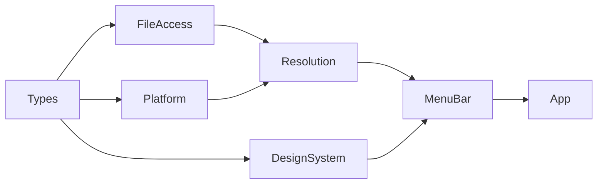
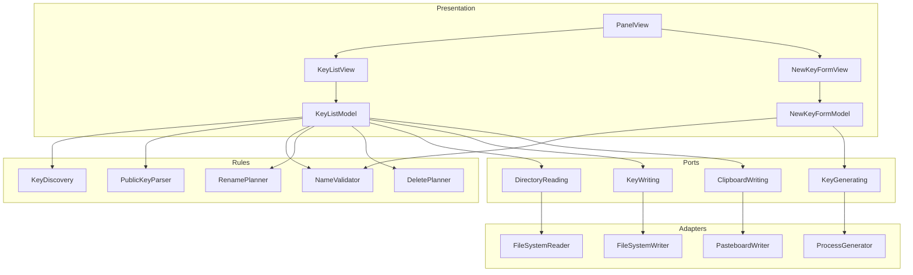
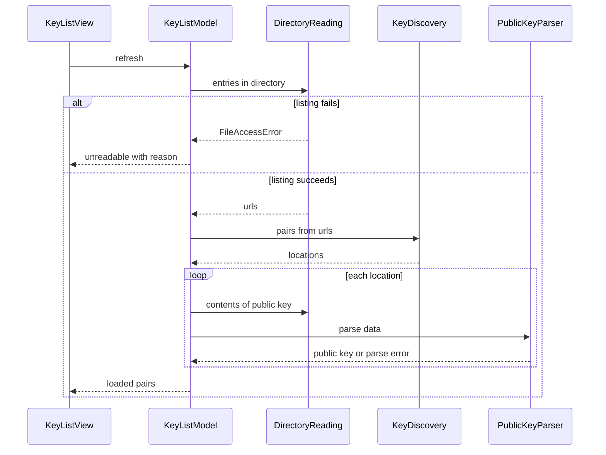
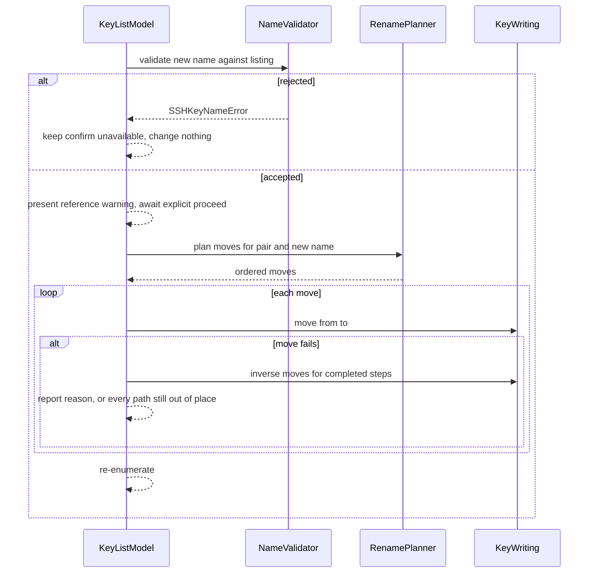
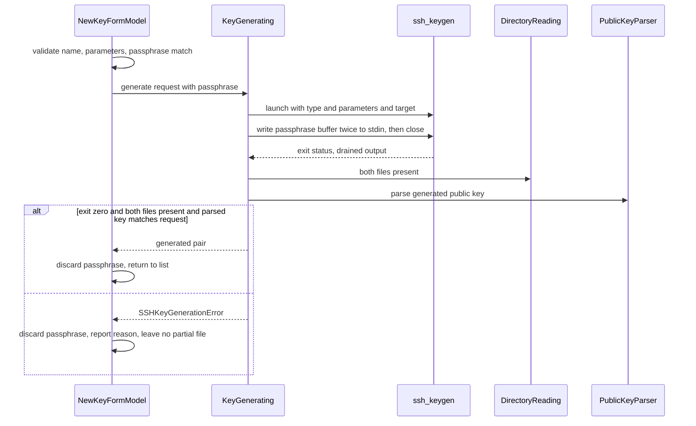
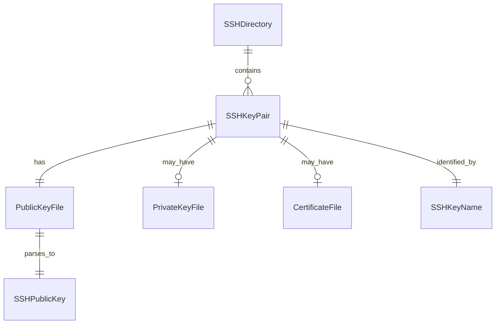

# Technical Design — crud-ssh-keys

## Overview

**Purpose**: This feature delivers the key-pair surface of open-ssh-gui — list, copy, rename, delete and create — to developers and operators who maintain `~/.ssh` by hand and want a visual check on it.

**Users**: A developer opens the menu bar panel to confirm which identities the machine holds, copies a public key into a hosting provider, renames a default-named key to something meaningful, removes one that is no longer used, or generates one for a new machine without recalling `ssh-keygen` flags.

**Impact**: This is the first feature that writes to `~/.ssh` and the first that launches a subprocess. The read-only guarantee the foundation established structurally is preserved by adding **separate** narrow ports rather than widening `SSHDirectoryReading`. The menu bar panel gains a second surface and therefore a route; the design system's temporary showcase is removed.

### Goals

- Present every key pair in the resolved SSH directory with its type, size, fingerprint and comment, derived entirely from the public key file.
- Mutate `~/.ssh` only through narrow, individually fakeable ports, with all-or-nothing semantics on every multi-file operation.
- Generate keys through `ssh-keygen` with the passphrase never present in a process listing, and with the silent-downgrade hazard unreachable rather than merely detected.
- Keep `MenuBarExtra` the only scene and the panel one fixed size.
- Leave every appearance decision to the Design System layer.

### Non-Goals

- Parsing `~/.ssh/config`, honouring `Include`, or updating any reference to a renamed key. See the note under Requirement 6 for why a rename warns instead, and what is deferred.
- Editing the comment inside an existing public key, changing an existing key's passphrase, importing, exporting, converting or certifying keys.
- `ssh-agent` interaction, `authorized_keys`, anything on a remote host.
- Watching the SSH directory for external change; Trash or any other undo for a deletion.
- Recovering a key pair whose public key file is missing, which discovery cannot see.

## Boundary Commitments

### This Spec Owns

- Key pair **discovery** from the resolved SSH directory, and the exclusion rules that define what is a key pair.
- **Public key parsing** and every attribute derived from it: algorithm, size, fingerprint, comment.
- Key **name validation**, including the collision rule, applied identically to rename and creation.
- The **rename**, **delete** and **create** operations, their plans, their rollback semantics and their confirmations.
- The three new ports — `SSHKeyWriting`, `SSHKeyGenerating`, `ClipboardWriting` — and their contracts.
- The panel's **route** between the key list and the create form, and the panel's fixed size.

### Out of Boundary

- `SSHDirectoryReading` and `SSHDirectoryResolver`, which are consumed unchanged. **This design does not widen the read port.**
- Which directory is the SSH directory; `SSHDirectoryStatusModel` remains authoritative and keeps its once-per-launch memoization.
- Component appearance, owned by the Design System layer.
- **The confirmation gate itself**, owned by the Design System's confirming button style. This spec owns only the title and message it supplies (7.9).
- Configuration parsing, and therefore Requirement 6.4, which stays `Where`-gated and dormant.
- Key format and key generation internals, owned by `ssh-keygen`.

### Allowed Dependencies

- `SSHDirectoryReading` for listing and reading public key files.
- `SSHDirectory` as the containment anchor for every mutation.
- The **Design System layer** for every control, enumerated in Design System Components Consumed. **Hard prerequisite** — the `design-system` spec must ship before implementation begins, including its Requirements 3.9 to 3.11, which were added so a confirmation can name what it is about to destroy.
- `/usr/bin/ssh-keygen`, injected as an absolute path.
- Apple SDK frameworks only. No third-party dependency.
- **Constraint**: nothing in this feature may import `FileManager` outside `FileAccess/`, construct an adapter outside the composition root, or reach the file system from a view.

### Revalidation Triggers

- A change to `SSHDirectoryReading`'s shape or to `SSHDirectory`.
- A change to the exclusion rules, which would alter what the config spec may assume is a key.
- The arrival of configuration reading, which activates Requirement 6.4 and opens the deferred opt-in.
- A change to the panel's fixed height or route enum, which every later panel surface depends on.
- A change to the Design System's component contracts.

## Architecture

### Existing Architecture Analysis

The foundation is four layers with a one-way dependency direction, a single composition root, and a read-only file port whose adapter is `nonisolated` with `@concurrent` methods. Patterns this design preserves:

- **No default values on injected dependencies**, so a missing injection fails to compile.
- **Typed throws** carrying the offending `URL` and exposing a user-facing `reason`, so no error object reaches a view.
- **Projections on the value, not the view** — `SSHDirectoryStatus.displayPath` is the template.
- **Closed enums** in which an invalid combination is unrepresentable.
- **Worst-case height reservation** in the panel, because `menuBarExtraStyle(.window)` sizes to content and a mid-layout height change produces `_NSDetectedLayoutRecursion`.

Technical debt worked around rather than resolved: the `.window` style's content-sizing defect. This design does not fix the defect; it removes the project's dependence on content sizing.

### Architecture Pattern & Boundary Map

**Selected pattern**: layered ports and adapters, extended with one new layer. `FileAccess/` is reserved by `structure.md` as the only place permitted to import `FileManager`; a process port and a pasteboard port are ports and adapters that are not file access, so they take a sibling layer `Platform/` rather than a tenancy in `FileAccess/`.





**Architecture Integration**:

- **Domain boundaries**: pure rules in `Resolution/` know nothing of ports; models own orchestration and in-flight state; views own nothing.
- **Existing patterns preserved**: single composition root, no defaulted injections, typed throws, closed status enums, value-level projections.
- **New components rationale**: three narrow ports because three distinct capabilities are needed and interface segregation keeps a copy-only consumer from holding deletion; pure planner types so ordering and rollback are testable without a file system; a route enum because the panel now has two surfaces.
- **Steering compliance**: `SSHDirectoryReading` is untouched; `FileManager` stays inside `FileAccess/`; every adapter is `nonisolated` with `@concurrent` methods; no third-party dependency.

**Decision worth stating**: `SSHKeyWriting` exposes **move and remove, but no create**. The only code path that brings a file into existence is `ssh-keygen`. This makes `product.md`'s "defer to OpenSSH" commitment structural rather than conventional.

### Technology Stack

| Layer | Choice / Version | Role in Feature | Notes |
|-------|------------------|-----------------|-------|
| UI | SwiftUI, `MenuBarExtra` only scene | Panel, key list, create form | Fixed panel height; route enum, not `NavigationStack` |
| UI appearance | Design System layer (this project) | Every control | Hard prerequisite |
| Rules | Swift 6.4 toolchain, language mode 5 | Pure discovery, parsing, validation, planning | Typed throws; no I/O |
| File mutation | Foundation `FileManager` | Move and remove, inside `FileAccess/` only | `moveItem` preserves permissions and refuses an existing destination |
| Key generation | `/usr/bin/ssh-keygen` via Foundation `Process` | Generation, passphrase via piped stdin | Absolute path, injected, no default |
| Fingerprinting | CryptoKit `SHA256` | `SHA256:` fingerprint from the public key blob | Digest only; no key generation in-process |
| Clipboard | AppKit `NSPasteboard` | Public key copy, inside `Platform/` only | `AppKit` never imported by a view |
| Testing | Swift Testing | Pure rules directly; ports through fakes | Test target has no host application |

New dependencies on the existing stack: CryptoKit and AppKit, both Apple SDK frameworks.

### Design System Components Consumed

Named here so the seam between the two specs is explicit and neither builds what the other owns.

| Surface in this feature | Design System element | Its requirement |
|---|---|---|
| Key list | Composite list component, list row | 6.3, 6.1 |
| "No keys found" | Empty-state component | 8.1, 8.2 |
| Section headings | Section header component | 8.3 |
| Fingerprint, path, key line | Code text component | 7.4, 7.5 |
| Per-entry state, operation progress | Status indicator component | 7.1, 7.2 |
| Key attributes as key/value rows | `LabeledContentStyle` conformance | 4.2 |
| All buttons | `ButtonStyle` conformances; destructive appearance | 3.1, 3.3, 3.7 |
| **Delete confirmation, rename warning** | **Confirming button style, with caller-supplied title and message** | **3.8, 3.9, 3.10, 3.11** |
| Name field, comment field | Text field modifier, composite field component | 5.1, 5.3 |
| Key type and parameter choice | Enumerated-choice component | 9.2, 9.5 |
| Passphrase and confirmation fields | Secret field component | 10.1, 10.3 |

**Two seams were ambiguous and are now settled.**

**Confirmation is owned by the Design System; the words are owned by this feature.** The
confirming button style gates activation and forbids any suppression affordance; this feature
supplies the title and message so a confirmation can name the key pair it is about to destroy
(7.1, 7.2, 7.9). `design-system` Requirements 3.9 to 3.11 were added for this. The alternative
— a confirmation flow built here — was rejected because it would put two confirmation
mechanisms in one app and let a future destructive action bypass the gate.

**Reveal policy is owned by this feature.** The secret field reports a reveal request and
does not act on it (`design-system` 10.3). `NewKeyFormModel` holds the revealed flag, which is
what 10.6 means by "only when the user explicitly requests it".

Any value these components need that no token defines is added as a token, not written inline
(13.3, `design-system` 2.7).

## File Structure Plan

### Directory Structure

```
open-ssh-gui/
├── Types/
│   ├── SSHKeyName.swift              # Validated base name; .pub is derived, never supplied
│   ├── SSHKeyNameError.swift
│   ├── SSHKeyType.swift              # ed25519 | rsa(RSAKeyLength) | ecdsa(ECDSACurve)
│   ├── SSHPublicKey.swift            # Parsed algorithm, size, fingerprint, comment
│   ├── SSHKeyAlgorithm.swift         # Wire algorithm names
│   ├── SSHFingerprint.swift
│   ├── SSHKeyPair.swift              # Locations plus parsed-or-unreadable public key
│   ├── SSHKeyPairLocation.swift      # Pure pairing result, before any read
│   ├── Passphrase.swift              # Redacting value type
│   ├── SSHPublicKeyError.swift
│   ├── SSHKeyGenerationRequest.swift # Name, type, comment. Carries no secret.
│   ├── SSHKeyWriteError.swift
│   └── SSHKeyGenerationError.swift
├── FileAccess/
│   ├── SSHKeyWriting.swift           # Port: move, remove. No create.
│   └── FileSystemSSHKeyWriter.swift
├── Platform/                         # NEW layer: ports and adapters that are not file access
│   ├── SSHKeyGenerating.swift
│   ├── ProcessSSHKeyGenerator.swift
│   ├── ClipboardWriting.swift
│   └── PasteboardClipboardWriter.swift
├── Resolution/
│   ├── SSHKeyDiscovery.swift         # [URL] -> [SSHKeyPairLocation]; pure
│   ├── SSHPublicKeyParser.swift      # Data -> SSHPublicKey; pure
│   ├── SSHKeyNameValidator.swift     # Pure; shared by rename and create
│   ├── SSHKeyRenamePlan.swift        # Pure; ordered moves plus inverse
│   └── SSHKeyDeletePlan.swift        # Pure; ordered removals
└── MenuBar/
    ├── PanelRoute.swift              # Closed: keyList | newKey
    ├── PanelView.swift               # Fixed-size host; owns the route
    ├── SSHKeyListModel.swift         # @MainActor @Observable; orchestration, in-flight state
    ├── SSHKeyListState.swift         # Closed: loading | loaded | unreadable | noDirectory
    ├── KeyOperation.swift            # Closed: idle | renaming | deleting | generating
    ├── SSHKeyListView.swift
    ├── SSHKeyRowView.swift           # Delete gated by the confirming button style; no own dialog
    ├── RenameSheetView.swift         # Name entry; warning and gate via the confirming button style
    ├── NewKeyFormModel.swift         # @MainActor @Observable; form state and validation
    ├── NewKeyFormState.swift         # Field values plus per-field validation projection
    └── NewKeyFormView.swift

open-ssh-guiTests/Support/
├── InMemorySSHKeyWriter.swift        # Records moves and removes; can fail a chosen path
├── StubSSHKeyGenerator.swift         # Returns a fabricated outcome; never launches a process
└── RecordingClipboardWriter.swift
```

Test files follow the existing one-per-production-type convention and are not listed.

### Modified Files

- `open-ssh-gui/OpenSSHGUIApp.swift` — constructs the three new adapters and the two models; presents `PanelView`. Remains the only place that constructs an adapter.
- `open-ssh-gui/MenuBar/SSHDirectoryStatusView.swift` — becomes a section inside `PanelView` rather than the panel's whole content; keeps the Quit control's placement obligations (12.4).
- **Deleted**: the `design-system` spec's showcase source files, per its Requirement 14.8 and this spec's 12.3.

## System Flows

### Discovery and listing



A parse failure or an unreadable public key degrades **that entry only** (1.6, 2.6); the listing still presents every other pair. An empty listing and an unreadable directory are distinct states (1.7, 1.8), which is why `SSHKeyListState` is a closed enum rather than an array plus an optional error.

### Rename with rollback



Rollback is an ordered sequence of inverse moves, not a transaction: each move is a rename within one directory and therefore individually reversible. Permissions need no explicit handling — `moveItem` preserves them. A second operation cannot begin while one is in flight because `KeyOperation` has no case for two (4.7).

### Generation



**Three decisions carry this flow.** The passphrase is written as **one buffer twice**, so the two prompts cannot receive different values — this makes the silent-downgrade hazard unreachable rather than detected afterwards. stdin is closed after the write and both output streams are drained, so no prompt can block. **Exit status alone is not accepted as success**: the gate is exit 0 *and* both files present *and* the parsed public key's algorithm and size matching what was requested.

## Requirements Traceability

| Requirement | Summary | Components | Interfaces | Flows |
|---|---|---|---|---|
| 1.1–1.5, 1.9 | Discovery, pairing, exclusions | `SSHKeyDiscovery`, `SSHKeyListModel` | `SSHDirectoryReading` | Discovery |
| 1.6, 2.6 | Degrade one entry, keep the rest | `SSHKeyPair`, `SSHPublicKeyParser` | — | Discovery |
| 1.7, 1.8 | Empty vs unreadable distinguished | `SSHKeyListState` | — | Discovery |
| 1.10, 11.6 | Responsive during I/O | adapters | `@concurrent` methods | — |
| 2.1–2.5 | Metadata from the public key only | `SSHPublicKeyParser`, `SSHPublicKey` | — | Discovery |
| 3.1–3.6 | Clipboard | `SSHKeyListModel` | `ClipboardWriting` | — |
| 4.1–4.6 | Rename as a unit, rollback | `SSHKeyRenamePlan`, `SSHKeyListModel` | `SSHKeyWriting` | Rename |
| 4.7 | One operation at a time | `KeyOperation` | — | Rename |
| 5.1–5.8 | Name validation and collision | `SSHKeyNameValidator`, `SSHKeyName` | — | Rename |
| 6.1–6.3, 6.5 | Reference warning, nothing else modified | `SSHKeyListModel`, `RenameSheetView` | — | Rename |
| 6.4 | Config entry list | — | — | **Dormant**: no configuration reading exists |
| 7.1–7.8 | Delete with confirmation | `SSHKeyDeletePlan`, `SSHKeyListModel` | `SSHKeyWriting` | — |
| 8.1–8.10 | Create form | `NewKeyFormModel`, `NewKeyFormState`, `SSHKeyType` | — | Generation |
| 9.1–9.8 | Generation | `ProcessSSHKeyGenerator` | `SSHKeyGenerating` | Generation |
| 10.1–10.3 | Private key material | `SSHKeyWriting` has no read; parser reads only `.pub` | — | — |
| 10.4–10.8 | Passphrase handling | `Passphrase`, `ProcessSSHKeyGenerator` | `SSHKeyGenerating` | Generation |
| 11.1–11.5, 11.7, 11.8 | Mutation safety | `FileSystemSSHKeyWriter`, planners | `SSHKeyWriting` | Rename |
| 12.1–12.9 | Panel and navigation | `PanelView`, `PanelRoute` | — | — |
| 13.1–13.9 | Design system adoption | all views | Design System contracts | — |
| 14.1–14.7 | Testability | fakes in `Support/`; pure rules | all ports | — |

## Components and Interfaces

| Component | Layer | Intent | Req Coverage | Key Dependencies | Contracts |
|---|---|---|---|---|---|
| `SSHKeyName` | Types | A name that cannot be invalid | 5 | — | State |
| `SSHKeyType` | Types | Type with only its own parameters | 8.4, 8.5 | — | State |
| `SSHPublicKey` | Types | Parsed public key attributes | 2 | — | State |
| `Passphrase` | Types | A secret that cannot be printed | 10.4, 10.8 | — | State |
| `SSHKeyDiscovery` | Resolution | Listing to key pairs, purely | 1.2–1.5, 14.6 | — | Service |
| `SSHPublicKeyParser` | Resolution | Public key bytes to attributes | 2.1–2.4, 14.5 | CryptoKit (P0) | Service |
| `SSHKeyNameValidator` | Resolution | The name rules, shared | 5.1–5.8 | — | Service |
| `SSHKeyRenamePlan` | Resolution | Ordered moves and their inverse | 4.2, 4.6 | — | Service |
| `SSHKeyDeletePlan` | Resolution | Ordered removals | 7.3 | — | Service |
| `SSHKeyWriting` | FileAccess | Move and remove. No create. | 4, 7, 11 | — | Service |
| `SSHKeyGenerating` | Platform | Generation through OpenSSH | 9, 10.5 | ssh-keygen (P0) | Service |
| `ClipboardWriting` | Platform | Public key to pasteboard | 3 | AppKit (P0) | Service |
| `SSHKeyListModel` | MenuBar | Orchestration and in-flight state | 1, 3, 4, 6, 7 | all ports (P0) | State |
| `NewKeyFormModel` | MenuBar | Form state and validation | 8, 9, 10.6, 10.7 | `SSHKeyGenerating` (P0) | State |
| `PanelRoute`, `PanelView` | MenuBar | Two surfaces, one fixed size | 12 | Design System (P0) | State |
| Views | MenuBar | Rendering only | 13 | Design System (P0) | — |

Views carry no detail block: they introduce no boundary, hold no logic and read nothing. Their obligation is Requirement 13 — appearance from the Design System, every value from an injected model.

### Types

#### SSHKeyType

| Field | Detail |
|---|---|
| Intent | A key type that carries exactly the parameters applicable to it |
| Requirements | 8.3, 8.4, 8.5, 9.1 |

**Responsibilities & Constraints**
- Closed over Ed25519, RSA and ECDSA, each case carrying only its own parameters.
- `.ed25519` carrying a bit length, or `.rsa` carrying a curve, is a **compile error** rather than a validation rule. This is how 8.5 is satisfied structurally.
- Owns the `ssh-keygen` argument spelling for each case, so no call site assembles flags.

**Contracts**: State ☑

##### State Management
```swift
enum SSHKeyType: Equatable, Sendable, CaseIterable {
    case ed25519
    case rsa(RSAKeyLength)
    case ecdsa(ECDSACurve)
}

enum RSAKeyLength: Int, Equatable, Sendable, CaseIterable {
    case bits2048 = 2048, bits3072 = 3072, bits4096 = 4096
}

enum ECDSACurve: Int, Equatable, Sendable, CaseIterable {
    case nistp256 = 256, nistp384 = 384, nistp521 = 521
}
```
- Invariants: a value cannot express a type-parameter combination `ssh-keygen` would reject.
- `CaseIterable` over the parameter enums supplies the form's choices (8.4) without any view enumerating them.

#### Passphrase

| Field | Detail |
|---|---|
| Intent | A secret that cannot be printed, logged or reflected into a message |
| Requirements | 10.4, 10.6, 10.7, 10.8 |

**Responsibilities & Constraints**
- Wraps the entered bytes with private storage, conforming to `CustomStringConvertible` and `CustomDebugStringConvertible` to return a redacted marker. Without those conformances Swift's reflection would render the contents into any interpolated message.
- Does **not** conform to `Codable`, so it cannot be serialised anywhere.
- Exposes a single consuming accessor for the generator. **It does not claim to scrub memory.** Requirement 10.7 is stated as "retain no reference", which is what a value type can discharge: the form drops its reference on every exit path and the generator's copy goes out of scope when `generate` returns. Nothing zeroes the bytes, because nothing can — the text system held the passphrase before this type existed and `String`'s copy-on-write buffers may hold copies beyond the app's reach. An earlier draft promised a `clear()`; that was removed as unachievable rather than left in as reassurance.
- The enforceable protections are elsewhere and are structural: never written to a file or log (10.4), never in argv or the environment (10.5), never in an error message (10.8).
- Carries the empty case as a value, so "no passphrase" is data rather than a sentinel (8.8).

**Contracts**: State ☑

### Resolution

#### SSHKeyDiscovery

| Field | Detail |
|---|---|
| Intent | Turn a directory listing into key pair locations, with no I/O |
| Requirements | 1.2, 1.3, 1.4, 1.5, 14.5, 14.6 |

**Responsibilities & Constraints**
- Pure function over `[URL]`. Performs **no** file-system access, which is what makes 14.6 reachable.
- Derives a pair from each `*.pub` entry; the sibling without the extension is the private key when the listing contains it, absent otherwise (1.3).
- Excludes `config`, `known_hosts`, `authorized_keys` and directories (1.4); attaches `<name>-cert.pub` to its pair rather than listing it (1.5). The certificate rule matches `ssh_config(5)`, which states that `ssh(1)` derives a certificate path by appending `-cert.pub` to the identity path.
- Owns the reserved-name list, which `SSHKeyNameValidator` also consults, so the two cannot disagree.

**Dependencies**
- Inbound: `SSHKeyListModel` — supplies the listing (P0)

**Contracts**: Service ☑

##### Service Interface
```swift
struct SSHKeyDiscovery {
    static let reservedNames: Set<String>
    func pairLocations(in entries: [URL]) -> [SSHKeyPairLocation]
}
```
- Preconditions: `entries` are the immediate children of one directory.
- Postconditions: one element per `*.pub` entry that is not a certificate; ordered by name for a stable presentation.
- Invariants: no element names a path outside the supplied entries' directory.

#### SSHPublicKeyParser

| Field | Detail |
|---|---|
| Intent | Derive every presented attribute from public key bytes |
| Requirements | 2.1, 2.2, 2.3, 2.4, 14.5 |

**Responsibilities & Constraints**
- Pure function over `Data`. Reads **only** the public key file's bytes; nothing in this feature reads a private key (2.2, 10.1).
- Splits the line into **at most three** fields, so a comment containing spaces survives intact (2.4).
- Treats the algorithm name **inside** the blob as authoritative, since that is what OpenSSH verifies against, not the line's first field.
- Computes the fingerprint as `"SHA256:" + base64(SHA256(blob))` with `=` padding stripped — verified to match `ssh-keygen -l` for Ed25519, RSA and ECDSA (2.3).
- Derives size from the modulus bit length for RSA, the curve name for ECDSA, and a constant for Ed25519.
- Computing a digest is not implementing a key format; generation stays with `ssh-keygen` (9.2).

**Dependencies**
- External: CryptoKit `SHA256` — digest only (P0)

**Contracts**: Service ☑

##### Service Interface
```swift
struct SSHPublicKeyParser {
    func parse(_ data: Data) -> Result<SSHPublicKey, SSHPublicKeyError>
}
```
- Preconditions: none; arbitrary bytes are a valid input and must not trap.
- Postconditions: success yields algorithm, size, fingerprint and optional comment; failure names the condition (1.6).
- Invariants: no force unwrap, no `try!`; a truncated or malformed blob returns a failure rather than crashing.

#### SSHKeyNameValidator

| Field | Detail |
|---|---|
| Intent | The name rules, applied identically to rename and creation |
| Requirements | 5.1–5.8 |

**Responsibilities & Constraints**
- Pure. One implementation serves both operations, which is how 5.8 is satisfied without duplication.
- Rejects empty or whitespace-only names, path separators and traversal, a `.pub` suffix, reserved OpenSSH names, and any name whose derived files would replace an existing entry (5.1–5.5).
- Takes the name being replaced, so a rename that keeps its own name is not reported as a self-collision.
- Collision is computed against **every** file the operation would write — private, public and certificate — not only the private key (5.5).

**Contracts**: Service ☑

##### Service Interface
```swift
struct SSHKeyNameValidator {
    func validate(
        _ proposed: String,
        against entries: [URL],
        replacing current: SSHKeyName?
    ) -> Result<SSHKeyName, SSHKeyNameError>
}
```
- Postconditions: success yields a `SSHKeyName` no caller can construct otherwise; failure names the rule and, for a collision, the file that would have been replaced.
- Invariants: pure; never touches the file system.

#### SSHKeyRenamePlan

| Field | Detail |
|---|---|
| Intent | The ordered moves a rename performs, and their inverse |
| Requirements | 4.2, 4.6, 11.5 |

**Responsibilities & Constraints**
- Pure. Produces the ordered moves for private key, public key and certificate when present, so ordering and completeness are unit-testable without a file system.
- Produces the **inverse** of any prefix of its own steps, which is what the model executes on failure (4.6).
- Decides nothing about validity; it consumes an already-validated `SSHKeyName`.

**Contracts**: Service ☑

##### Service Interface
```swift
struct SSHKeyRenamePlan {
    struct Move: Equatable, Sendable { let from: URL; let to: URL }
    init(pair: SSHKeyPair, newName: SSHKeyName)
    var moves: [Move] { get }
    func inverse(ofCompleted count: Int) -> [Move]
}
```
- Preconditions: `newName` validated against the same listing the pair came from.
- Postconditions: every `to` is inside the pair's directory (11.1); the public key's `to` is its private key's `to` plus `.pub` (4.3).
- Invariants: no step modifies file contents (4.4).

### FileAccess

#### SSHKeyWriting

| Field | Detail |
|---|---|
| Intent | The only file mutation this feature performs |
| Requirements | 4.2, 4.6, 7.3, 11.1–11.7 |

**Responsibilities & Constraints**
- **Move and remove only. No create.** Nothing in this feature brings a file into existence except `ssh-keygen`.
- A separate port from `SSHDirectoryReading`, which is **not** widened. A component holding only the read port still cannot mutate anything.
- Each method is a single file operation; multi-file semantics belong to the planners and the model, so the adapter stays trivial.
- `nonisolated` type with `@concurrent` methods, so mutation never runs on the main actor (11.6). `nonisolated` alone is insufficient under `SWIFT_APPROACHABLE_CONCURRENCY = YES`, as `FileSystemSSHDirectoryReader` documents.
- The adapter is the only new type permitted to import `FileManager`.

**Dependencies**
- Inbound: `SSHKeyListModel` — rename and delete execution (P0)
- External: Foundation `FileManager` (P0)

**Contracts**: Service ☑

##### Service Interface
```swift
protocol SSHKeyWriting: Sendable {
    func move(from source: URL, to destination: URL) async throws(SSHKeyWriteError)
    func remove(at url: URL) async throws(SSHKeyWriteError)
}

enum SSHKeyWriteError: Error, Equatable, Sendable {
    case destinationExists(URL)
    case notFound(URL)
    case accessDenied(URL)
    case failed(URL)
    var url: URL { get }
    var reason: String { get }
}
```
- Preconditions: both URLs inside the resolved SSH directory; the caller has validated the destination.
- Postconditions: `move` preserves the moved file's permissions and **never** replaces an existing destination; `remove` deletes exactly one file.
- Invariants: no method creates a file; no method writes file contents.

**Implementation Notes**
- Integration: `moveItem` was verified to preserve POSIX permissions (`0600` stayed `0600`) and to refuse an existing destination with `NSCocoaErrorDomain` 516 rather than clobbering it. Requirement 11.4 therefore needs no explicit permission code, and 11.2 gains a backstop beneath the validator — even a defective validator cannot destroy a bystander file through this path.
- Validation: the error mapping follows `FileAccessError`'s precedent, consulting both the Cocoa code and the underlying POSIX error so absence stays distinguishable from denial.
- Risks: deletion is irreversible by product decision (7.2); the confirmation in the model is the only guard, and 7.8 forbids suppressing it.

### Platform

#### SSHKeyGenerating

| Field | Detail |
|---|---|
| Intent | Generate a key pair through OpenSSH, with the passphrase never in argv |
| Requirements | 9.1–9.8, 10.5 |

**Responsibilities & Constraints**
- Launches `ssh-keygen` at an **absolute injected path**, never resolved through `PATH`. A hijacked `PATH` would otherwise choose the binary that handles the user's passphrase.
- Supplies the passphrase on **piped stdin**, verified to work with no tty, so nothing appears in a process listing (10.5). `-N` is forbidden; the environment carries no secret (10.5).
- Writes **one passphrase buffer twice** and closes stdin. Because both prompts receive the same bytes, the mismatch that silently produces an unencrypted key **cannot occur** — the hazard is unreachable rather than detected.
- Drains stdout and stderr concurrently with the wait, so a prompt or verbose output cannot fill a pipe and deadlock.
- **Does not accept exit status as proof of success.** The acceptance gate is exit 0 **and** both files present **and** the parsed public key's algorithm and size matching the request.
- Owns no policy: it does not validate the name, choose defaults or decide collisions.
- `nonisolated` type with `@concurrent` methods.

**Dependencies**
- Inbound: `NewKeyFormModel` (P0)
- Outbound: `SSHPublicKeyParser` — verify the generated key (P0)
- External: `/usr/bin/ssh-keygen` via Foundation `Process` (P0)

**Contracts**: Service ☑

##### Service Interface
```swift
protocol SSHKeyGenerating: Sendable {
    func generate(
        _ request: SSHKeyGenerationRequest,
        passphrase: Passphrase,
        in directory: SSHDirectory
    ) async throws(SSHKeyGenerationError) -> SSHKeyPair
}

struct SSHKeyGenerationRequest: Equatable, Sendable {
    let name: SSHKeyName
    let type: SSHKeyType
    let comment: String
}

enum SSHKeyGenerationError: Error, Equatable, Sendable {
    case toolUnavailable(URL)
    case directoryMissing(URL)
    case toolFailed(status: Int32, reason: String)
    case outputMissing(URL)
    case outputMismatch(expected: SSHKeyType, actual: SSHKeyAlgorithm)
    case timedOut
    var reason: String { get }
}
```
- Preconditions: `request.name` validated against a current listing; `directory` the resolved SSH directory.
- Postconditions on success: both files exist, the private key is owner-read/write only and the public key world-readable, and the returned pair's attributes were parsed from the file actually written. On any failure: no partially written file remains (9.6).
- Invariants: the passphrase never enters argv, the environment, a log or an error message (10.5, 10.8); the request carries no secret.

**Implementation Notes**
- Integration: `ssh-keygen` produces `0600`/`0644` unaided, so 11.3 needs no explicit permission step. A non-existent target directory exits 1, which maps to `directoryMissing` (9.7). The pre-flight collision check in 5.5 means the `Overwrite (y/n)?` prompt is never reached; closing stdin means it could not block if it were.
- Validation: `outputMismatch` exists because an acceptance gate that only checked file presence would still pass a key of the wrong type.
- Risks: `Process` pipe draining under Swift 6 concurrency is the least-settled mechanism in this design — the shape is known, the exact `AsyncSequence` versus handler choice is not. A timeout bounds the worst case. Generation continues across panel dismissal (9.8), so the task must not be owned by a view's lifetime.

#### ClipboardWriting

| Field | Detail |
|---|---|
| Intent | Place a public key on the system clipboard |
| Requirements | 3.1, 3.2, 3.5, 3.6 |

**Responsibilities & Constraints**
- A port so that `AppKit` stays out of every view and the behaviour is assertable without touching the real pasteboard (13.6, 14.1).
- Writes a single line, byte-for-byte as stored, with no trailing newline (3.2).
- Takes an already-read value; it never reads a file, which is what makes 3.5 structural — it has no way to reach a private key.
- Performs no clearing or expiry; a public key is not a secret (3.6).

**Dependencies**
- External: AppKit `NSPasteboard` (P0)

**Contracts**: Service ☑

##### Service Interface
```swift
protocol ClipboardWriting: Sendable {
    func write(_ text: String) async
}
```
- Preconditions: `text` is a public key line read from a `.pub` file.
- Postconditions: the clipboard holds exactly `text`; a failure to read upstream leaves the clipboard untouched (3.4).

### MenuBar

#### SSHKeyListModel

| Field | Detail |
|---|---|
| Intent | Orchestrate discovery, copy, rename and delete, and own in-flight state |
| Requirements | 1, 3, 4, 6, 7, 11.7 |

**Responsibilities & Constraints**
- `@MainActor @Observable`, the single source of truth for what the list presents.
- No initializer parameter has a default value, following `SSHDirectoryStatusModel`: a missing injection is a compile error rather than a silent fallback to the real file system.
- Composes pure rules with ports; contains no parsing, validation or planning of its own.
- Re-enumerates after every completed mutation (1.9) and on each panel open.
- Holds `KeyOperation`, a closed enum with no case for two concurrent operations, which is how 4.7 is enforced rather than asserted.
- Mutates only as the direct result of a confirmed user action (11.7).
- Never retains a passphrase; the create flow belongs to `NewKeyFormModel`.

**Dependencies**
- Outbound: `SSHDirectoryReading` (P0), `SSHKeyWriting` (P0), `ClipboardWriting` (P0), the four pure rule types (P0)
- Inbound: `SSHDirectoryStatusModel` — the resolved directory (P0)

**Contracts**: State ☑

##### State Management
```swift
enum SSHKeyListState: Sendable, Equatable {
    case loading
    case loaded([SSHKeyPair])
    case unreadable(FileAccessError)
    case noDirectory(SSHDirectoryResolutionError)
}

enum KeyOperation: Sendable, Equatable {
    case idle
    case renaming(SSHKeyName)
    case deleting(SSHKeyName)
}
```
- State model: `loaded([])` is "no keys found"; `unreadable` is "could not be read". Separate cases, so 1.7's distinction cannot be lost by presenting an empty array for both.
- Concurrency: every port call is `await`ed off the main actor; the model mutates state only back on the main actor.
- Persistence: none. The model holds no state that outlives the launch.

**Implementation Notes**
- Integration: presentation projections (`displayName`, `attributeSummary`, `isPrivateKeyMissing`) live on `SSHKeyPair`, not on the view, following `SSHDirectoryStatus.displayPath`.
- Validation: the rename flow validates, then warns about references (6.1), then executes — in that order, so a rejected name never produces a warning dialog. The warning and the delete confirmation are both the Design System's confirming button style with a title and message supplied here; this feature builds no confirmation surface of its own.
- Risks: a failed rollback leaves the directory mid-rename. The model reports every path still out of place (4.6) rather than claiming a clean failure.

#### NewKeyFormModel

| Field | Detail |
|---|---|
| Intent | Hold create-form state, validate it, and run generation |
| Requirements | 8, 9.3, 9.4, 9.8, 10.6, 10.7 |

**Responsibilities & Constraints**
- `@MainActor @Observable`. Owns the field values and a per-field validation projection; the generate control's availability is derived, never stored (8.9).
- Presents only the selected type's parameters, and discards a parameter that does not apply when the type changes (8.5) — expressible because `SSHKeyType` cannot hold both.
- Requires the passphrase twice and reports a mismatch **before** generation is attempted (8.7). With the generator writing one buffer twice, this is the only place a mismatch can be caught, which makes it load-bearing rather than a convenience.
- States that an empty passphrase leaves the private key unencrypted, and allows it (8.8).
- Drops its `Passphrase` reference on success, on failure and on cancel (10.7). It does not scrub memory — see the `Passphrase` block for why that is not claimed.
- Owns the reveal flag for the secret field, which reports a request and does not act on it (10.6, `design-system` 10.3).
- Discards all entered values on cancel without writing anything (8.10).
- Generation is owned by the model, not a view's `task`, so panel dismissal does not cancel it (9.8).

**Dependencies**
- Outbound: `SSHKeyGenerating` (P0), `SSHKeyNameValidator` (P0)
- Inbound: `PanelView` — route transitions (P0)

**Contracts**: State ☑

##### State Management
- State model: field values plus a derived `[FieldIdentifier: SSHKeyNameError]`-shaped projection and a `generating` flag; the submit control reads the projection.
- Concurrency: generation is one `Task` the model owns and can be asked about; a second submission is impossible while it runs (9.3).
- Persistence: none. The passphrase is cleared on every exit path.

#### PanelView and PanelRoute

| Field | Detail |
|---|---|
| Intent | Host both surfaces at one fixed size |
| Requirements | 12.1–12.9 |

**Responsibilities & Constraints**
- Keeps `MenuBarExtra` the only scene (12.1) and retains the Quit control with its shortcut, outside any scrolling region (12.4).
- Gives the panel an **exact fixed height**, so no surface is content-sized. `menuBarExtraStyle(.window)` has a documented defect in which a `ScrollView` lays out correctly on first open and collapses on later opens; the forum report states `maxHeight` does not fix it and `fixedSize` does — but `fixedSize` sizes to content and defeats a bounded list. An exact height makes both the defect and `_NSDetectedLayoutRecursion` unreachable, generalising the existing `reservedStatusHeight` from one row pair to the whole panel (12.5–12.7).
- **`NavigationStack` is rejected.** Its behaviour inside a content-sized `NSPanel` is undocumented and it is the change most likely to reintroduce the recursion. A closed `PanelRoute` enum is testable and matches the project's preference for unrepresentable invalid states (12.8).
- Presents the key list in place of the design system's showcase and the showcase's sources are deleted (12.2, 12.3).
- Keeps the SSH directory status alongside the list (12.9).

**Contracts**: State ☑

##### State Management
```swift
enum PanelRoute: Sendable, Equatable {
    case keyList
    case newKey
}
```
- State model: one route, owned by `PanelView`. No surface can be presented twice and none can be absent.

## Data Models

### Domain Model

The aggregate is the **key pair**, identified by its base name within one resolved directory. Its files — private key, public key, optional certificate — are not independently meaningful: every OpenSSH tool derives the public path from the private path by appending `.pub`, which is why rename and delete operate on the whole pair (4.2, 7.3).



**Invariants**
- A pair exists only where a public key file exists. Discovery runs from `*.pub`, so a private key whose public key was deleted is invisible — accepted and recorded in the requirements' boundary context.
- The private key file is optional; the public key file is not (1.3).
- Every file in a pair shares one base name, and the public key's name is the private key's plus `.pub` (4.3).
- A name is either validated or not constructed: `SSHKeyName` has no unchecked initialiser (5).
- A pair's attributes are either parsed or an explicit failure; "silently missing" is not representable (1.6, 2.6).

### Logical Data Model

```swift
struct SSHKeyPairLocation: Equatable, Sendable {
    let name: SSHKeyName
    let publicKeyURL: URL
    let privateKeyURL: URL?
    let certificateURL: URL?
}

struct SSHKeyPair: Equatable, Sendable, Identifiable {
    let location: SSHKeyPairLocation
    let publicKey: Result<SSHPublicKey, SSHPublicKeyError>
    var id: SSHKeyName { location.name }
}

struct SSHPublicKey: Equatable, Sendable {
    let algorithm: SSHKeyAlgorithm
    let bitLength: Int
    let fingerprint: SSHFingerprint
    let comment: String?
}
```

**Structure and integrity**
- `SSHKeyPairLocation` is the pure output of discovery, before any file is read; `SSHKeyPair` adds the parse outcome. The split is what lets 14.6 be tested with no I/O.
- Identity is `SSHKeyName`, which is unique within a directory because it comes from a filename. Requirement 7.7 depends on this: a deletion acts on an entry the user selected, matched by identity.
- `comment` is `String?` rather than `""`, so 2.4's "no comment" is distinguishable from an empty comment.
- No persistence and no cache. Every refresh re-reads (1.9), which is also why an externally renamed key is picked up on the next panel open without a file watcher.

### Data Contracts & Integration

The only external data contract is the OpenSSH public key line, which this feature reads and never writes:

| Field | Position | Notes |
|---|---|---|
| Algorithm | 1 | Present for compatibility; the in-blob name is authoritative |
| Blob | 2 | base64; length-prefixed fields yield algorithm, curve or modulus |
| Comment | 3 | Optional, may contain spaces; the line splits into at most three fields |

Serialization is OpenSSH's, not this app's. No file's contents are rewritten by any operation in this spec (4.4).

## Error Handling

### Error Strategy

Every failure is a typed enum carrying the offending `URL` and exposing a `reason: String`, following `FileAccessError`. No error object reaches a view; the model maps every error to a presentable state. There is no `try!`, no `fatalError` on user input and no force unwrap outside tests and `@main` wiring.

Two strategies are used deliberately rather than uniformly. **Validation fails fast**: a bad name is rejected before any file is touched, and the confirming control stays unavailable (5.6, 5.7). **Mutation degrades to a reported partial state**: a multi-file operation that cannot complete restores what it can and names what it could not (4.6, 7.6), because silently claiming failure after a half-finished rename would be worse than an accurate report.

### Error Categories and Responses

**User errors** — rejected before any mutation. Empty, separator-bearing, `.pub`-suffixed, reserved and colliding names each name their rule, and a collision names the file that would have been replaced (5.1–5.5). A passphrase mismatch is reported before generation (8.7).

**Environment errors** — reported, nothing changed. An unreadable directory presents its reason instead of an empty list (1.8). A missing directory is reported rather than created (9.7). An unavailable `ssh-keygen` reports that generation is unavailable (9.5).

**Partial-failure errors** — the only category with recovery logic. A failed rename move triggers the inverse of the completed prefix and reports the reason (4.6); if rollback itself fails, every path still out of place is named. A failed deletion names the files that remain (7.6). A failed generation leaves no partial file (9.6).

**Degraded entries** — an unreadable or unparseable public key marks that entry and leaves the rest of the listing intact (1.6, 2.6).

Errors never include a passphrase or a private key path (10.8).

### Monitoring

No telemetry, no analytics and no crash reporting: `product.md` commits that no `~/.ssh` content leaves the device, and an error `reason` may contain a path. Diagnosis is the user-facing reason plus the test suite.

## Testing Strategy

Tests are written before the implementation. Nothing reaches the real `~/.ssh`: the test target has no host application, every file and process touch goes through an injected conformer, and no test source names the home directory or a literal SSH directory path.

### Unit Tests (pure rules, no doubles needed)

- `SSHPublicKeyParser` returns the fingerprint, algorithm, size and comment for Ed25519, RSA and ECDSA fixtures, and a typed failure for truncated, non-base64 and single-field input without trapping.
- `SSHPublicKeyParser` preserves a comment containing spaces, and distinguishes an absent comment from an empty one.
- `SSHKeyDiscovery` pairs a `.pub` with its private key, reports an absent private key, excludes `config`, `known_hosts`, `authorized_keys` and directories, and attaches `-cert.pub` to its pair rather than listing it.
- `SSHKeyNameValidator` rejects each prohibited name with its own case, accepts a rename that keeps its current name, and reports a collision against the public key and certificate as well as the private key.
- `SSHKeyRenamePlan` orders its moves, derives the public key's destination by appending `.pub`, and returns the correct inverse for every prefix length.

### Integration Tests (model plus fakes)

- Renaming through `InMemorySSHKeyWriter` moves all three files; making the second move fail leaves every file at its original name and reports the reason.
- A deletion removes all three files; a removal failure names the files that remain.
- Copying places the public key line on `RecordingClipboardWriter` unchanged, and an unreadable public key leaves the recorder empty.
- `SSHKeyListModel` distinguishes an empty directory from an unreadable one, and degrades a single unparseable entry without dropping the rest.
- `KeyOperation` refuses a second mutation while one is in flight.
- `StubSSHKeyGenerator` drives the form's success, `toolUnavailable`, `outputMismatch` and `directoryMissing` paths without launching a process.

### Adapter Tests (scratch directory, real file system)

- `FileSystemSSHKeyWriter.move` preserves permissions, refuses an existing destination, and maps absence and denial to distinct cases.
- A write completes while the main actor is blocked, which fails if `@concurrent` is removed — mirroring `FileSystemSSHDirectoryReaderTests.readCompletesWhileTheMainActorIsBlocked`.
- `ProcessSSHKeyGenerator` against a **stub executable**, not `ssh-keygen`: asserts the passphrase reaches stdin and appears in neither argv nor the environment, that stdin is closed, that a non-zero exit maps to `toolFailed`, and that a non-terminating stub hits the timeout.

### UI Verification

Appearance is verified by preview and inspection, per the design system's own testing approach. Two behaviours need a real launch against a scratch directory via `--ssh-directory`: that the panel does not resize when the route changes, and that no `_NSDetectedLayoutRecursion` appears on repeated panel opens with a list longer than the panel.

## Security Considerations

- **No private key byte enters the app.** Discovery and metadata run entirely from `.pub` files; `SSHKeyWriting` can move and remove but not read; `ClipboardWriting` takes a string it is handed. Requirement 10.1 is therefore structural, not a rule to remember.
- **The passphrase never appears in a process listing.** It reaches `ssh-keygen` on piped stdin, never through `-N` or the environment. `Passphrase` redacts itself under reflection, so it cannot be interpolated into a message or log, and it is not `Codable`.
- **Memory scrubbing is not claimed.** 10.7 commits to retaining no reference, not to erasing bytes. The text system holds the passphrase before the app does and `String`'s buffers may copy it beyond reach, so a scrubbing claim would be false. The protections that are enforceable — nothing written, nothing in argv, nothing printed — are structural.
- **The silent downgrade is unreachable.** One buffer written twice means the two prompts cannot differ, so the path that silently produces an unencrypted key while exiting 0 cannot be taken.
- **`ssh-keygen` is launched by absolute path.** A `PATH` lookup would let a hijacked `PATH` choose the binary that receives the passphrase.
- **Blast radius is bounded by the resolved directory.** Every mutation is confined to it, including under `--ssh-directory`, and never falls back to the home directory (11.8) — the same accident the resolver's no-fallback rule exists to prevent.
- **`moveItem` will not clobber.** Even a defective validator cannot destroy a bystander file through the rename path.
- **Deletion is permanent and individually confirmed**, per `product.md`; 7.8 forbids a "do not ask again" affordance.
- Residual risk accepted by product decision: the App Sandbox is disabled, which is what makes direct `~/.ssh` access and launching `ssh-keygen` possible at all.

## Open Questions

1. **Panel sizing is verified by a spike before any other UI work.** The exact fixed height is the mechanism this design relies on to make the `.window` sizing defect and `_NSDetectedLayoutRecursion` unreachable, and it is unverified. The **first UI task** is therefore a spike: a fixed-height panel containing a list longer than the panel, exercised across repeated opens and a route switch, run against a scratch directory via `--ssh-directory`. **Pre-authorised fallback**: if `ScrollView` still collapses inside an exactly-sized container, the list renders a bounded `LazyVStack` instead — no redesign, and no decision deferred to whoever hits it. The height itself cannot be a number until the Design System's row metrics exist; the design commits to *an* exact height.
2. **`Process` pipe draining under Swift 6 concurrency.** The shape is settled — `nonisolated` type, `@concurrent` method, concurrent drain, timeout — the `AsyncSequence` versus `readabilityHandler` choice is not.
3. **Requirement 6.4 remains dormant.** It activates when configuration reading arrives, together with the opt-in deferred in the requirements' note.
