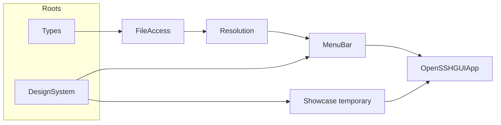
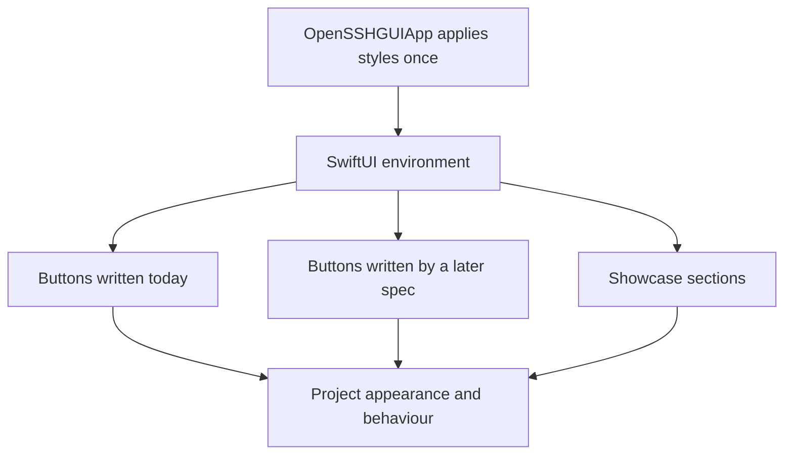
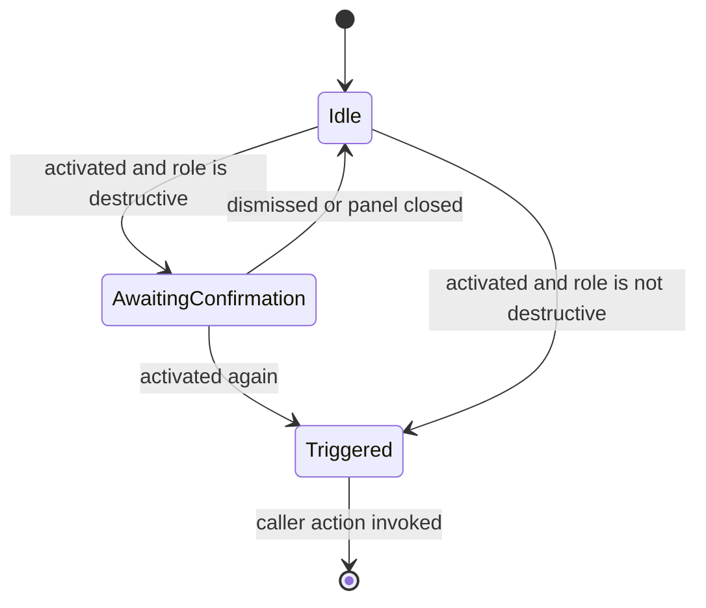
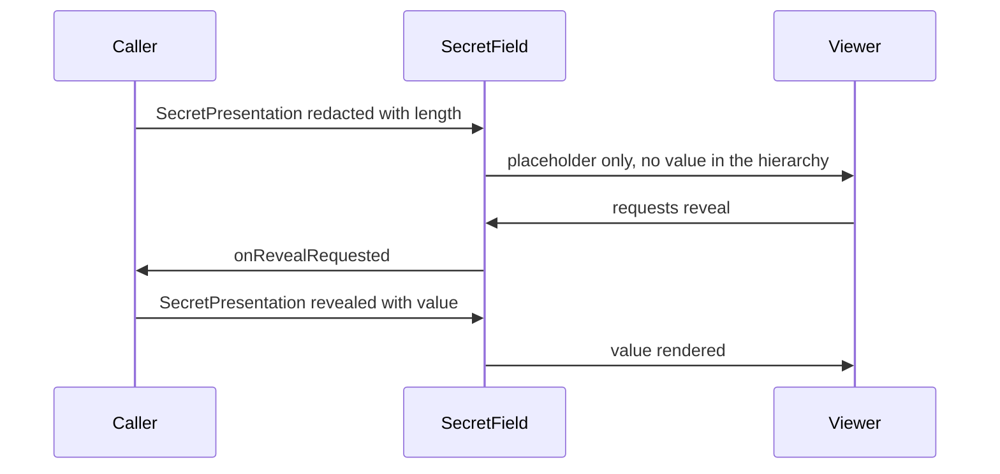

# Design Document

## Overview

**Purpose**: This feature delivers a reusable presentation vocabulary — design tokens plus
component abstractions — to every later feature of open-ssh-gui, so that a change to a class of
control is one edit rather than a search across views.

**Users**: Contributors building the host-configuration and key-management surfaces consume this
layer; the end user experiences it as a menu bar panel that behaves like a native macOS app.

**Impact**: Adds `DesignSystem/` as a dependency root beside `Types/`, and `Showcase/` as a
temporary demonstration surface. `SSHDirectoryStatusView` is rewired onto the new components.
The panel presents the showcase for this spec's duration. One structural `project.pbxproj`
change restores automatic target membership for new source files.

The central decision is to **style the native controls rather than replace them**. SwiftUI's
style protocols are applied once to an ancestor and propagate through the environment, so a
`Button` written later by a contributor who never read these documents still inherits the
project's appearance and behaviour. Three protocols — `TextFieldStyle`, `ListStyle`,
`PickerStyle` — are closed (verified against the macOS 27 SDK; see `research.md`), so those
controls use a `ViewModifier` plus a composite view instead. Standalone view types are reserved
for assemblies that have no underlying control to style.

### Goals

- One definition per visual decision, applied once and inherited (3.2, 4.3).
- Components driven entirely by their callers, with no second source of truth (11.1–11.7).
- Appearance decisions expressed as pure values, unit-testable without rendering (13.1–13.3).
- A temporary showcase that demonstrates every component at the panel's real width and is
  removable in one step (14.1–14.10).

### Non-Goals

- Parsing `~/.ssh/config`, host CRUD, key listing or generation, and all file writing.
- The reveal *policy* for key material, and the OpenSSH keyword vocabulary.
- A user-facing theme or appearance setting; a window scene; any third-party dependency.
- Bundle identifier, signing and notarization.

## Boundary Commitments

### This Spec Owns

- The `DesignSystem/` layer: tokens, style conformances, chrome modifiers and composite views.
- The token vocabulary — spacing, radii, typography, colour roles, density — and the colour
  sets backing it in `Assets.xcassets`.
- The closed input types that drive each component (`StatusRole`, `FieldValidation`,
  `SecretPresentation`, `EmptyStateContent`).
- The temporary `Showcase/` surface and its removal contract.
- The project-file change that restores automatic target membership, and the `structure.md`
  update describing the new layer.

### Out of Boundary

- Any SSH domain concept. `DesignSystem/` never names a keyword, a path, a key type or a host.
- The reveal flow, audit rules and definition of key material behind Requirement 10.
- The option vocabulary behind Requirement 9; the enumerated-choice component renders whatever
  the caller supplies.
- What the panel presents after the showcase is removed.
- Correcting the stale target-membership claim in `macos-menu-bar-foundation/research.md`, which
  is a historical record of that spec's discovery.

### Allowed Dependencies

- Apple SDK frameworks only: SwiftUI, Foundation (for `Sendable` values), Observation, Testing.
- `MenuBar/` and `Showcase/` may depend on `DesignSystem/`. The reverse is forbidden.
- `DesignSystem/` may depend on nothing else in the project — not `Types/`, not `FileAccess/`,
  not `Resolution/`.

### Revalidation Triggers

- A component's input type gains or loses a case — consumers must re-check exhaustive handling.
- The dependency direction changes, or `DesignSystem/` acquires a project dependency.
- A style moves from environment propagation to an explicit modifier, or vice versa — call sites
  must be re-audited, since propagation is what makes them bypass-proof.
- The colour-set naming convention changes, since generated symbol names are derived from it.
- `Assets.xcassets` leaves the test target, which would break every colour reference under test.

## Architecture

### Existing Architecture Analysis

The shipped foundation is a layered ports-and-adapters arrangement whose dependency direction is
enforced by directory rather than by module: the app is one target, and the test target compiles
the production sources directly. Patterns this design preserves:

- **Closed enums with tested projections.** `SSHDirectoryStatus` exposes `displayPath`,
  `isReachable` and `failureReason`, asserted in `SSHDirectoryStatusTests` with no view. This is
  the exact shape Requirements 7.2 and 13.1 ask for.
- **Explicit `Sendable` on value types**, which keeps them nonisolated under
  `SWIFT_DEFAULT_ACTOR_ISOLATION = MainActor`.
- **Views hold no logic.** `SSHDirectoryStatusView` renders a model and triggers one refresh.
- **Bounded panel height.** `@ScaledMetric reservedStatusHeight` exists because a height change
  during panel layout produced `_NSDetectedLayoutRecursion` (`c38363c`).

Two pieces of technical debt are addressed rather than worked around:

1. **Target membership.** New files currently join neither target automatically; the app target
   has no synchronized group and its membership is an explicit per-file list. This design fixes
   the configuration once (verified — see `research.md`) instead of paying ~20 per-file entries.
2. **`SSHDirectoryStatus`'s projection shape.** `isReachable: Bool` plus
   `failureReason: String?` can express "reachable and failing" even though the enum cannot. The
   design system defines its own closed `StatusRole` and a tested mapping, keeping the leak out
   of the new layer.

### Architecture Pattern & Boundary Map



**Architecture Integration**:

- **Selected pattern**: environment-propagated styles over native controls, with `ViewModifier`
  plus composite views where the style protocol is closed. Rejected alternatives and the SDK
  evidence are in `research.md`.
- **Domain boundaries**: `DesignSystem/` owns appearance and never names an SSH concept;
  `MenuBar/` owns what to show; `Showcase/` owns only the demonstration.
- **Dependency direction**: `DesignSystem/` is a **root**, like `Types/`. It is not inserted
  between `Resolution/` and `MenuBar/`, because it depends on nothing in the project and
  a linear chain would overstate its coupling. A reference from `DesignSystem/` into any other
  project directory is an error, not a style question.
- **Existing patterns preserved**: closed enums with tested projections; explicit `Sendable`;
  logic-free views; bounded panel heights; one primary type per file.
- **Steering compliance**: no third-party dependency; `struct`/`enum` over `class` (this layer
  introduces no reference type); `private` by default; narrow inputs per component.

### Technology Stack

| Layer | Choice / Version | Role in Feature | Notes |
|-------|------------------|-----------------|-------|
| UI | SwiftUI, macOS 27 SDK | style protocols, modifiers, composites | `ButtonStyle`, `PrimitiveButtonStyle`, `LabelStyle`, `LabeledContentStyle`, `ToggleStyle` verified implementable |
| UI tokens | `EnvironmentValues` + `@Entry` macro | subtree-overridable tokens (2.6) | compiles under `SWIFT_VERSION = 5.0`; verified |
| Assets | `Assets.xcassets`, generated Swift asset symbols | colour sets backing `ColorRole` (2.3) | catalog joins the test target; symbol names strip a trailing `Color` |
| Runtime | `MenuBarExtra` with `.menuBarExtraStyle(.window)` | the only scene (14.10) | self-sizing panel; all heights explicit |
| Testing | Swift Testing | pure projections and token reads (13.1–13.5) | existing target, still no host application |
| Build | Xcode project, `objectVersion = 90` | synchronized group membership | one structural change, verified |

No new dependency is introduced.

## File Structure Plan

### Directory Structure

```
open-ssh-gui/
├── DesignSystem/
│   ├── Tokens/
│   │   ├── Spacing.swift              # namespaced spacing scale
│   │   ├── Radius.swift               # namespaced corner radii
│   │   ├── Typography.swift           # text styles, relative to system styles
│   │   ├── ColorRole.swift            # closed semantic colour vocabulary, pure value
│   │   ├── ColorRoleAppearance.swift  # ColorRole to Color, the only asset-symbol site
│   │   └── Density.swift              # @Entry environment token
│   ├── Styles/
│   │   ├── PanelButtonStyle.swift     # ButtonStyle: appearance, pressed, disabled, role
│   │   ├── ConfirmingButtonStyle.swift# PrimitiveButtonStyle: gates activation
│   │   ├── PanelLabelStyle.swift      # LabelStyle
│   │   ├── PanelRowStyle.swift        # LabeledContentStyle
│   │   ├── PanelToggleStyle.swift     # ToggleStyle
│   │   ├── FieldChrome.swift          # ViewModifier: TextFieldStyle is closed
│   │   └── RowChrome.swift            # ViewModifier: ListStyle is closed
│   ├── Components/
│   │   ├── LabeledField.swift         # label + field + reserved validation slot
│   │   ├── BoundedList.swift          # collection + empty state + explicit height
│   │   ├── ChoiceRow.swift            # enumerated choice: PickerStyle is closed
│   │   ├── SecretField.swift          # redacted by construction
│   │   ├── StatusIndicator.swift      # icon + message + role tint
│   │   ├── CodeText.swift             # monospaced, selectable, middle truncation
│   │   ├── EmptyState.swift           # message + optional icon + optional action
│   │   └── SectionHeader.swift        # grouping header, exposed as a heading
│   └── Inputs/
│       ├── StatusRole.swift           # closed: success, warning, failure, inProgress
│       ├── FieldValidation.swift      # closed: valid, invalid(message)
│       ├── SecretPresentation.swift   # closed: redacted(length), revealed(value)
│       └── EmptyStateContent.swift    # message, optional symbol, optional action
├── Showcase/                          # TEMPORARY - removed by the next feature spec
│   ├── ShowcasePanel.swift            # scrolling region of bounded height
│   └── ShowcaseSections.swift         # one section per component, all states
└── Assets.xcassets/                   # gains one colour set per ColorRole case
```

`Tokens/` and `Inputs/` hold pure values with no SwiftUI view code beyond
`ColorRoleAppearance.swift`. `Styles/` holds the propagating conformances and the two chrome
modifiers. `Components/` holds the composites — every one of them an assembly with no single
native control to style.

Test files mirror production names under `open-ssh-guiTests/`, one per type with a testable
projection: `StatusRoleTests`, `FieldValidationTests`, `SecretPresentationTests`,
`ColorRoleTests`, `SpacingTests`, `TypographyTests`, and a `StatusRoleMappingTests` for the
`SSHDirectoryStatus` translation. Styles and composites have no unit tests — their decisions
live in the input types, which is what Requirement 13.1 mandates.

### Modified Files

- `open-ssh-gui.xcodeproj/project.pbxproj` — app target gains the `open-ssh-gui` synchronized
  root group; its `membershipExceptions` list empties; `Assets.xcassets` leaves the test
  target's exception list. Verified; see `research.md`.
- `open-ssh-gui/OpenSSHGUIApp.swift` — applies the styles once to the panel's root and presents
  `ShowcasePanel`. One line is the showcase's entire attachment point (14.8).
- `open-ssh-gui/MenuBar/SSHDirectoryStatusView.swift` — renders the path through `CodeText` and
  the reachability row through `StatusIndicator`; the inline `@ScaledMetric` height and
  hand-built rows give way to design system components (7.6).
- `open-ssh-gui/MenuBar/SSHDirectoryStatus.swift` — gains a `statusRole` projection mapping to
  `StatusRole`. The existing projections stay; nothing is removed.
- `open-ssh-gui/Assets.xcassets` — one colour set per `ColorRole` case.
- `.kiro/steering/structure.md` — documents `DesignSystem/` as a root and `Showcase/` as
  temporary.
- `AGENTS.md` — corrects the claim that new files join the app target automatically, which
  becomes true again only after the project-file change.

## System Flows

### Style propagation — why a call site cannot bypass the system



The gate is that `Button`, `Label`, `LabeledContent` and `Toggle` remain the entry points. A
contributor who writes a plain `Button` inherits the style; there is nothing to remember. The
three closed protocols break this guarantee, which is why `FieldChrome`, `RowChrome` and
`ChoiceRow` are the only places where forgetting is possible, and why Requirement 13.6's
previews exist.

### Destructive activation — inline confirmation



`ConfirmingButtonStyle` withholds `configuration.trigger()` until a second activation. No modal
is presented: a `.menuBarExtraStyle(.window)` panel has no key window and dismisses on outside
click, and `confirmationDialog` presentation from that surface is unverified (`research.md`).
The pending flag lives in a nested private `View` and its only effect is whether the caller's
closure runs — a bounded exception to Requirement 11.4, recorded as such rather than disguised.

### Secret reveal — the value is absent until the caller grants it



`privacySensitive()` is not used: it requires a `.privacy` redaction reason that an app does not
set, and it does not withhold the string from VoiceOver. Keeping the value out of the view until
the caller grants it makes Requirements 10.2 and 10.7 structural.

## Requirements Traceability

| Requirement | Summary | Components | Interfaces | Flows |
|---|---|---|---|---|
| 1.1–1.3, 1.6, 1.7 | layer boundaries, no project deps | `DesignSystem/` layout | — | Boundary Map |
| 1.4 | MenuBar sources appearance from the layer | `SSHDirectoryStatusView` | `CodeText`, `StatusIndicator` | — |
| 1.5 | no `SSH` prefix | naming scheme | — | — |
| 2.1, 2.2, 2.7 | spacing, radius, typography tokens | `Spacing`, `Radius`, `Typography` | namespaced enums | — |
| 2.3 | colours in the asset catalog | `ColorRole`, `ColorRoleAppearance` | `ColorRole` to `Color` | — |
| 2.4 | prefer system semantics | `ColorRoleAppearance` | — | — |
| 2.5 | typography relative to text styles | `Typography` | — | — |
| 2.6 | subtree-overridable tokens | `Density` | `EnvironmentValues` via `@Entry` | — |
| 3.1–3.5, 3.7, 3.9 | button appearance, states, role | `PanelButtonStyle` | `ButtonStyle` | Style propagation |
| 3.2 | inherited by every descendant | `OpenSSHGUIApp` | — | Style propagation |
| 3.6, 3.8 | activation interception, confirmation | `ConfirmingButtonStyle` | `PrimitiveButtonStyle` | Destructive activation |
| 4.1, 4.3–4.6 | label appearance and truncation | `PanelLabelStyle` | `LabelStyle` | Style propagation |
| 4.2 | key/value rows | `PanelRowStyle` | `LabeledContentStyle` | — |
| 5.1, 5.2, 5.8 | field chrome, no `TextFieldStyle` | `FieldChrome` | `ViewModifier` | — |
| 5.3–5.7, 5.9, 5.10 | composite field, validation, focus | `LabeledField` | `FieldValidation`, `Binding` | — |
| 6.1, 6.2, 6.8 | row chrome, no `ListStyle` | `RowChrome` | `ViewModifier` | — |
| 6.3–6.7 | composite list, selection, empty, bounded | `BoundedList` | `Binding`, `EmptyState` | — |
| 7.1–7.3, 7.7 | status indicator | `StatusIndicator` | `StatusRole` | — |
| 7.4, 7.5 | monospaced selectable code text | `CodeText` | — | — |
| 7.6 | existing view rewired | `SSHDirectoryStatus.statusRole` | `StatusRole` mapping | — |
| 8.1, 8.2, 8.6 | empty state | `EmptyState` | `EmptyStateContent` | — |
| 8.3–8.5 | section header as heading | `SectionHeader` | — | — |
| 9.1, 9.4, 9.7 | toggle appearance | `PanelToggleStyle` | `ToggleStyle` | — |
| 9.2, 9.3, 9.5, 9.6 | enumerated choice, caller options | `ChoiceRow` | generic over `Hashable` options | — |
| 10.1–10.7 | secret field | `SecretField` | `SecretPresentation` | Secret reveal |
| 11.1–11.7 | driven contract | every component | `Binding`, closures, closed inputs | — |
| 12.1–12.7 | adaptive appearance, accessibility | `ColorRoleAppearance`, `Typography`, all components | — | — |
| 13.1–13.3 | testable pure decisions | `Inputs/`, `Tokens/` | projections | — |
| 13.4, 13.5, 13.7 | test target constraints | test suites | — | — |
| 13.6 | previews per state | every component | `#Preview` | — |
| 14.1–14.10 | temporary showcase | `ShowcasePanel`, `ShowcaseSections` | — | Style propagation |

## Components and Interfaces

| Component | Layer | Intent | Req Coverage | Key Dependencies | Contracts |
|---|---|---|---|---|---|
| `Spacing`, `Radius`, `Typography` | Tokens | named scales, no literals elsewhere | 2.1, 2.2, 2.5, 2.7 | none (P0) | State |
| `ColorRole` | Tokens | closed semantic colour vocabulary as a pure value | 2.3, 12.5, 13.1 | none (P0) | State |
| `ColorRoleAppearance` | Tokens | the only asset-symbol reference site | 2.3, 2.4, 12.1–12.3 | `ColorRole` (P0), `Assets.xcassets` (P0) | Service |
| `Density` | Tokens | subtree-overridable token | 2.6 | `EnvironmentValues` (P0) | State |
| `PanelButtonStyle` | Styles | button appearance, pressed, disabled, role | 3.1, 3.3–3.5, 3.7, 3.9 | tokens (P0), `\.isEnabled` (P0) | State |
| `ConfirmingButtonStyle` | Styles | gate activation in one place | 3.6, 3.8 | `PrimitiveButtonStyle` (P0) | State |
| `PanelLabelStyle`, `PanelRowStyle`, `PanelToggleStyle` | Styles | label, row and toggle appearance | 4.1, 4.2, 4.4–4.6, 9.1, 9.7 | tokens (P0) | State |
| `FieldChrome`, `RowChrome` | Styles | chrome where the style protocol is closed | 5.1, 5.2, 6.1, 6.2 | tokens (P0) | State |
| `LabeledField` | Components | label + field + reserved validation slot | 5.3–5.7, 5.9, 5.10 | `FieldValidation` (P0), `FieldChrome` (P0) | State |
| `BoundedList` | Components | collection, selection, empty state, bounded height | 6.3–6.7 | `EmptyState` (P0), `RowChrome` (P1) | State |
| `ChoiceRow` | Components | enumerated choice over caller options | 9.2, 9.3, 9.5, 9.6 | none beyond tokens (P0) | State |
| `SecretField` | Components | redacted unless the caller grants a reveal | 10.1–10.7 | `SecretPresentation` (P0) | State |
| `StatusIndicator` | Components | icon, message, role tint | 7.1–7.3, 7.7 | `StatusRole` (P0) | State |
| `CodeText` | Components | monospaced, selectable, middle truncation | 7.4, 7.5, 7.7 | `Typography` (P0) | State |
| `EmptyState`, `SectionHeader` | Components | placeholder and grouping header | 8.1–8.6 | `EmptyStateContent` (P0) | State |
| `ShowcasePanel`, `ShowcaseSections` | Showcase | demonstrate every component and state | 14.1–14.9 | all components (P0) | State |

Only the components below introduce a new boundary. The remaining styles and composites are
presentational and are covered by the summary row plus the shared contract in
**Shared Component Contract**.

### Shared Component Contract

Every component in this layer obeys the same input rules, which is how Requirement 11 is
enforced structurally rather than by review:

- A displayed value arrives as a `let` property. A two-way value arrives as a `Binding` the
  caller owns. An action arrives as a closure.
- No component declares `@State` for a value with meaning outside it. The single bounded
  exception is `ConfirmingButtonStyle`'s pending flag, documented below.
- No component constructs or holds an observable model, a port conformer, or any service. No
  component imports anything from `Types/`, `FileAccess/` or `Resolution/`.
- Where an input could describe a state the component cannot render, the input is a closed type
  in `Inputs/` that cannot express it (11.7).
- Every component declares `#Preview`s covering each case of its input types (13.6).

### Tokens

#### ColorRole and ColorRoleAppearance

| Field | Detail |
|-------|--------|
| Intent | Name every semantic colour as a pure value, and map it to a catalog colour in exactly one place |
| Requirements | 2.3, 2.4, 12.1, 12.2, 12.3, 12.5, 13.1, 13.2 |

**Responsibilities & Constraints**

- `ColorRole` is a closed `Sendable, Equatable` enum naming intents — not hues. It is the value
  tests assert on, satisfying 13.1 and 13.2 without rendering.
- `ColorRoleAppearance` is the **only** site in the codebase that references a generated asset
  colour symbol. Concentrating it keeps the catalog dependency reviewable.
- Where a system semantic style expresses the intent (`.separator`, `.fill.quaternary`,
  `.primary`, `.secondary`, and the accent for prominence), the mapping uses it rather than a
  bespoke colour set (2.4). A colour set exists only where no system semantic fits.
- Colour sets are **not named with a trailing `Color`**: the symbol generator strips it, so
  `BorderColor` would yield `.border`. Names are chosen to read correctly after stripping.

**Dependencies**

- Outbound: `Assets.xcassets` — colour sets for roles with no system semantic (P0).
- External: none.

**Contracts**: Service [x] / State [x]

##### Service Interface

```
ColorRoleAppearance
    static func style(for role: ColorRole) -> some ShapeStyle
```

- Preconditions: none; every case of `ColorRole` is handled exhaustively.
- Postconditions: returns a style that adapts to appearance, contrast and accent.
- Invariants: no caller outside this type names a colour; no test asserts on the returned style.

**Implementation Notes**

- Integration: `Assets.xcassets` joins the test target, so this file compiles in both. The
  alternative — excluding it from the test target — cannot work, because exclusion cascades to
  every component file that calls the mapping (`research.md`).
- Validation: `ColorRoleTests` asserts the role vocabulary and that distinct intents are
  distinct cases. It does not assert on `Color` values.
- Risks: a role added without a matching colour set fails to compile, which is the desired
  failure. A test asserting on a `Color` would compile — prevented by convention, not the type
  system.

### Styles

#### PanelButtonStyle

| Field | Detail |
|-------|--------|
| Intent | Define button appearance once, inherited by every descendant `Button` |
| Requirements | 3.1, 3.3, 3.4, 3.5, 3.7, 3.9 |

**Responsibilities & Constraints**

- Conforms to `ButtonStyle` and is applied once in `OpenSSHGUIApp`, so call sites keep writing
  plain `Button` (3.1, 3.2).
- Provides prominent and plain variants, distinguished by more than colour (3.3, 12.5).
- `configuration.isPressed` drives the pressed appearance (3.4); `configuration.role ==
  .destructive` drives the destructive appearance (3.7).
- **`ButtonStyleConfiguration` carries no `isEnabled`.** The disabled appearance reads
  `\.isEnabled` from the environment (3.5). A style struct is not a `View`, so `@Environment`
  declared on it does not track; the read happens in a **nested private `View`** returned from
  `makeBody`. This shape is load-bearing, not incidental (`research.md`).
- Retains the native `Button`, so keyboard activation, focus ring and accessibility are
  unmodified (3.9).

**Dependencies**

- Inbound: `OpenSSHGUIApp` — applies the style once (P0).
- Outbound: `Spacing`, `Radius`, `Typography`, `ColorRoleAppearance` (P0); `\.isEnabled` (P0).

**Contracts**: State [x]

##### State Management

- State model: none of its own. Appearance is a function of the configuration plus the
  environment.
- Concurrency: `@MainActor` by default isolation, matching the protocol's own annotation.

**Implementation Notes**

- Integration: applied at the panel root alongside the label, row and toggle styles.
- Validation: a showcase section renders buttons in resting, pressed, disabled and destructive
  states, and a section that applies no local style proves propagation.
- Risks: reintroducing `@Environment` on the style struct would silently always report enabled.
  The nested-`View` shape is the mitigation and is worth a comment in the source.

#### ConfirmingButtonStyle

| Field | Detail |
|-------|--------|
| Intent | Intercept activation in one place, and require a second activation for destructive roles |
| Requirements | 3.6, 3.8 |

**Responsibilities & Constraints**

- Conforms to `PrimitiveButtonStyle`, whose configuration exposes `trigger()` — the only
  mechanism that allows activation to be deferred (3.6).
- For a `.destructive` role, the first activation moves to a confirming appearance; the second
  calls `trigger()` (3.8). Non-destructive roles trigger immediately.
- No modal presentation. A `.menuBarExtraStyle(.window)` panel has no key window and dismisses
  on outside click; `confirmationDialog` presentation from that surface is unverified.
- The pending flag lives in a nested private `View`. Its only effect is whether the caller's
  closure runs: it never alters caller data, and it resets when the view goes away.

**Dependencies**

- Inbound: any destructive `Button`, notably future key deletion (P0).
- Outbound: `ColorRoleAppearance`, `Typography` (P0).

**Contracts**: State [x]

##### State Management

- State model: a two-case local presentation state, idle or awaiting confirmation.
- Persistence: none. Panel dismissal discards it, which is the desired safety default.
- Consistency: the caller's action is invoked exactly once per confirmed activation.

**Implementation Notes**

- Integration: applied where a destructive affordance exists, not globally, since a primitive
  style replaces activation semantics for every descendant button.
- Validation: the showcase includes a destructive button; the state machine is documented in
  **System Flows**.
- Risks: this is the design's one deliberate breach of the "no component state" rule. It is
  recorded here and in `research.md` rather than glossed, so a reviewer can reject it if the
  project prefers caller-owned confirmation state instead.

### Components

#### LabeledField

| Field | Detail |
|-------|--------|
| Intent | Present a label, a text field and a validation message as one unit the caller drives |
| Requirements | 5.3, 5.4, 5.5, 5.6, 5.7, 5.9, 5.10 |

**Responsibilities & Constraints**

- Owns layout and the association between label and field (5.10). Owns no text and no verdict.
- Text arrives as `Binding<String>` (5.4); validity arrives as `FieldValidation` (5.5). The
  component never decides validity.
- **The validation slot is always occupied.** When valid, it reserves the message's height so
  showing a message never changes the component's height (5.7) — the same reasoning as
  `reservedStatusHeight`, using `@ScaledMetric` so it holds at any text size.
- Applies `FieldChrome` to a native `TextField`, so marked text, selection, undo and the
  Services menu are untouched (5.8).
- Focus, when the caller needs it, arrives as a `FocusState.Binding` (5.9).

**Dependencies**

- Outbound: `FieldChrome` (P0), `FieldValidation` (P0), `Spacing`, `Typography` (P0).

**Contracts**: State [x]

##### State Management

- State model: none owned. `text`, `validation` and optional focus all belong to the caller.
- Concurrency: `@MainActor`, as a view.

**Implementation Notes**

- Integration: the host-configuration spec is the first consumer; `ChoiceRow` and `SecretField`
  follow the same label-and-slot geometry so a form reads as one thing.
- Validation: `FieldValidationTests` asserts the closed type's projections; previews cover valid,
  invalid and long-message cases.
- Risks: reserving height costs vertical space in a small panel. Accepted, because an unbounded
  field is what produced the layout recursion this project already fixed once.

#### BoundedList

| Field | Detail |
|-------|--------|
| Intent | Render a caller-supplied collection with caller-supplied rows, an empty state, and a bounded height |
| Requirements | 6.3, 6.4, 6.5, 6.6, 6.7 |

**Responsibilities & Constraints**

- Generic over an element that the caller makes identifiable, so identity is the caller's
  commitment (6.5).
- Selection arrives as a `Binding` the caller owns (6.4).
- An empty collection renders `EmptyState` rather than an empty rows area (6.6).
- Scrolls within an explicit bounded height rather than growing the panel (6.7). Height is never
  derived from content.
- Wraps a native `List` so selection, keyboard navigation and accessibility are preserved (6.8).

**Dependencies**

- Outbound: `EmptyState` (P0), `RowChrome` (P1), `Spacing` (P0).

**Contracts**: State [x]

##### State Management

- State model: none owned; selection is the caller's.
- Consistency: the rendered rows are exactly the supplied collection, in supplied order.

**Implementation Notes**

- Integration: both the host list and the key list are intended consumers.
- Validation: previews cover empty, one row, and more rows than the bound.
- Risks: a native `List` inside a bounded region inside a self-sizing panel is the least certain
  construction in this design. If it proves unusable, the fallback is a `LazyVStack` of
  `RowChrome` rows, which keeps 6.1 intact but puts 6.8's native selection and keyboard
  navigation back in question. That trade would need recording as a requirement deviation.

#### SecretField

| Field | Detail |
|-------|--------|
| Intent | Render key material only after the caller grants a reveal, and hold nothing otherwise |
| Requirements | 10.1, 10.2, 10.3, 10.4, 10.5, 10.6, 10.7 |

**Responsibilities & Constraints**

- The input is `SecretPresentation`, a closed type whose redacted case carries **only a
  placeholder length** and whose revealed case carries the value. A redacted field therefore
  never receives the value at all (10.1, 10.2).
- A reveal request is reported to the caller; the component never reveals on its own authority
  (10.3). The caller supplies a revealed presentation to grant it (10.4).
- Never copies, logs or persists the value (10.5), and never reads a file (10.6).
- Because the value is absent while redacted, there is nothing to expose to assistive
  technologies (10.7). The accessibility label describes the field, not its contents.
- `privacySensitive()` and `redacted(reason: .privacy)` are **not** used: the reason is not set
  in an app, and neither withholds the string from VoiceOver (`research.md`).

**Dependencies**

- Inbound: the key-management spec, which owns the reveal policy (P0).
- Outbound: `SecretPresentation` (P0), `CodeText` for the revealed rendering (P1).

**Contracts**: State [x]

##### State Management

- State model: none owned. Redaction is a property of the input, not a mode the component holds.
- Invariants: no code path renders a value the caller has not marked revealed.

**Implementation Notes**

- Integration: the reveal flow, audit rules and definition of key material belong to the key
  spec; this component deliberately cannot pre-empt them.
- Validation: `SecretPresentationTests` asserts that the redacted case exposes no value —
  a property the type system makes checkable.
- Risks: a future contributor "simplifying" the input to `String` plus `isRevealed: Bool` would
  silently reintroduce the leak. The closed type is the guard and deserves a comment saying so.

#### StatusIndicator and the SSHDirectoryStatus mapping

| Field | Detail |
|-------|--------|
| Intent | Render a caller-supplied state as icon, message and tint |
| Requirements | 7.1, 7.2, 7.3, 7.6, 7.7 |

**Responsibilities & Constraints**

- `StatusRole` is a closed `Sendable, Equatable` enum over success, warning, failure and
  inProgress, in which reachable-and-failing is unrepresentable (7.2).
- Each case projects a symbol name and a `ColorRole`, so states differ by icon as well as tint
  (7.3, 12.5). Those projections are pure and unit-tested (13.1, 13.2).
- Content comes only from the caller (7.7).
- `SSHDirectoryStatus` gains a `statusRole` projection (7.6). The design system does **not**
  import the SSH status type; the mapping lives in `MenuBar/`, preserving the dependency
  direction.

**Dependencies**

- Inbound: `SSHDirectoryStatusView` (P0).
- Outbound: `StatusRole` (P0), `ColorRoleAppearance`, `Typography` (P0).

**Contracts**: State [x]

**Implementation Notes**

- Integration: replaces the hand-built `indicator` view; `CodeText` replaces `path`.
- Validation: `StatusRoleTests` covers every case's projections; `StatusRoleMappingTests` covers
  every `SSHDirectoryStatus` case, extending the existing `SSHDirectoryStatusTests` pattern.
- Risks: mapping four statuses onto four roles is currently one-to-one; a later status without a
  natural role would force a decision rather than a silent default. Exhaustive `switch` keeps
  that visible.

### Showcase

#### ShowcasePanel and ShowcaseSections

| Field | Detail |
|-------|--------|
| Intent | Demonstrate every component in every state at the panel's real width, and be deletable in one step |
| Requirements | 14.1–14.9 |

**Responsibilities & Constraints**

- Renders every component in every state its input types can express (14.1, 14.2), at the
  existing fixed panel width with no horizontal scrolling (14.3).
- The scrolling region takes an explicit `@ScaledMetric` bounded height so the panel never
  resizes as content changes (14.4) and AppKit does not re-enter layout (14.5).
- The Quit control stays outside the scrolling region (14.6).
- Declares its own values and reads nothing from the SSH directory (14.7).
- Lives entirely in `Showcase/`; removal is deleting that directory plus one line in
  `OpenSSHGUIApp.swift` (14.8), and the source says it is temporary and that the next feature
  spec removes it (14.9).
- `MenuBarExtra` remains the only scene (14.10).

**Implementation Notes**

- Integration: one section per component, each headed by `SectionHeader` so the showcase
  demonstrates that component too. One section deliberately applies no local button style, to
  prove propagation from the scene root.
- Validation: the exit criterion is visual, so this component carries no unit tests; its
  correctness claim is that every input case appears.
- Risks: `SSHDirectoryStatusView` is rewired but not presented while the showcase occupies the
  panel, so 7.6's rewiring is verified by preview and by compilation rather than by use. The
  next spec restores it.

## Error Handling

### Error Strategy

This layer performs no I/O, parses nothing and can fail no operation, so it defines no error
type and throws nothing. Its analogue of error handling is **making invalid input
unrepresentable**, per Requirement 11.7 and the project's type-safety standard.

### Error Categories and Responses

- **Invalid caller input** — prevented at compile time. `FieldValidation`, `StatusRole`,
  `SecretPresentation` and `EmptyStateContent` are closed types; a combination such as
  "valid but carrying an error message", or "redacted but holding the value", cannot be
  constructed.
- **Absent content** — not an error. An empty collection is a first-class rendering handled by
  `EmptyState` (6.6).
- **Caller-reported failure** — data, not an exception. A failure is a `StatusRole` case or a
  `FieldValidation.invalid` message that the component renders.
- **Missing token** — a compile error. A `ColorRole` case without a mapping fails to build,
  which is the intended outcome (2.7).

### Monitoring

None. This layer logs nothing, by design: `product.md` forbids `~/.ssh` content leaving the
device, and a component that logged what it rendered would be a channel for exactly that. The
`SecretField` in particular never writes its value anywhere (10.5).

## Testing Strategy

The layer's testable surface is its input types and tokens, not its views — SwiftUI offers no
way to assert on rendered output, and the project takes no third-party view-inspection
dependency. Requirement 13.1 is what makes this workable: every appearance decision is a pure
projection on a value type, so the decisions are tested even though the rendering is not.

### Unit Tests

- `StatusRoleTests` — every case projects a distinct symbol name and colour role, so no two
  states are distinguishable by tint alone (7.2, 7.3, 12.5).
- `FieldValidationTests` — `invalid` carries a message, `valid` exposes none; the pair cannot
  co-occur (5.5, 5.6, 11.7).
- `SecretPresentationTests` — the redacted case exposes no value under any accessor (10.2, 10.7).
- `ColorRoleTests` — the role vocabulary is complete and distinct; no assertion on `Color` (2.3).
- `SpacingTests`, `TypographyTests` — tokens are readable without constructing a view, and the
  scale is monotonic (2.1, 13.3).

### Integration Tests

- `StatusRoleMappingTests` — every `SSHDirectoryStatus` case maps to exactly one `StatusRole`,
  extending the existing `SSHDirectoryStatusTests` pattern (7.6).
- Compilation is itself the integration check for the layering rule: `DesignSystem/` referencing
  a project type fails the build, because the layer imports only SDK frameworks (1.2).
- `xcodebuild … test` passes with no host application, and no test names a home directory or an
  SSH path (13.4, 13.5, 13.7).

### UI Tests

None. There is no UI test target and Requirement 13.4 forbids adding a host application, which
a UI test target would require. The substitutes are `#Preview`s per component state (13.6) and
the showcase (14.1, 14.2).

### Manual Verification

Requirement 12 has no automated path and is verified by inspection, once, against the showcase:
light and dark appearance; increased contrast; a changed system accent; a changed text size;
every state distinguishable with colour disregarded; VoiceOver reaching every control and
reporting no redacted value; and legibility over the panel's material.

## Security Considerations

Only one component touches sensitive data, and the design's security claim is structural rather
than procedural: **`SecretField` cannot leak a value it never receives.** Its input omits the
value while redacted, so no code path — rendering, accessibility, or a future "simplification"
that adds logging — has a value to expose.

Two further constraints follow from `product.md` and AGENTS.md:

- No component logs, copies or persists anything it renders (10.5). The layer has no logging at
  all, so this is not a rule to remember.
- `DesignSystem/` cannot read the file system: it imports no `FileManager` and depends on no
  port (1.3). A component that wanted to display a file's contents would have to be given them.

The destructive-confirmation gate (3.8) is a safety control, not merely visual: AGENTS.md
requires key deletion to be confirmed in the UI, and `ConfirmingButtonStyle` is where that
becomes hard to bypass for every destructive button at once.

## Supporting References

- `research.md` — the SDK interface evidence for every style-protocol claim, the compile probes
  for `@Entry`, `#Preview` and the five style conformances, the verified project-file recipe,
  and the sources behind the `isEnabled`, `confirmationDialog` and `privacySensitive` decisions.
- `gap-analysis.md` — the current-state investigation, the requirement-to-asset map and the
  approach options. Note that its recommended colour strategy is superseded by this design, for
  the reason recorded in `research.md`.
