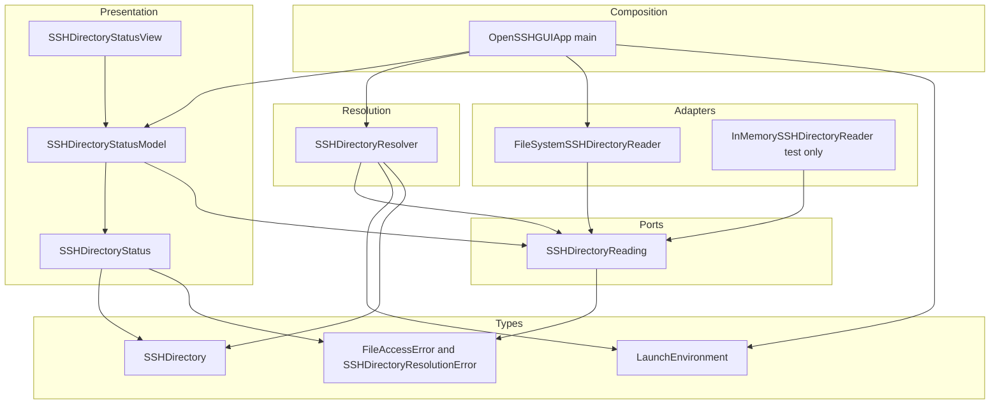
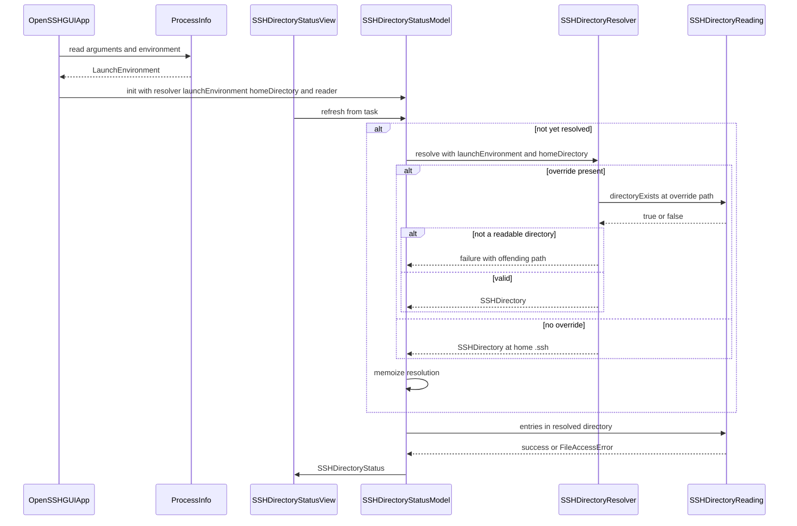
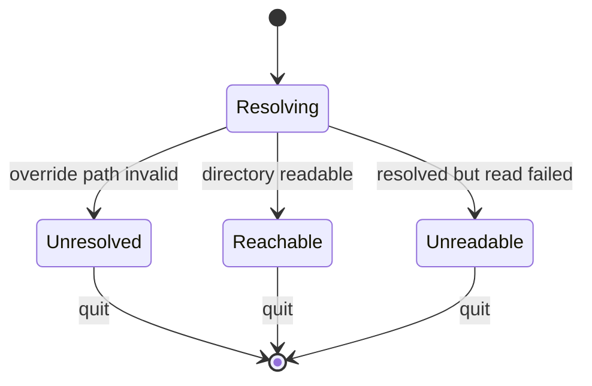

# Technical Design: macos-menu-bar-foundation

## Overview

**Purpose**: This feature converts the stock Xcode multiplatform template into the structural foundation of open-ssh-gui — a macOS-only, menu-bar-resident SwiftUI application that can reach the user's SSH directory through an injectable, read-only seam, and that can be pointed at a throwaway directory during development.

**Users**: The developer of open-ssh-gui is the primary user of everything in this spec. The end user sees only the menu bar item and the directory it reports.

**Impact**: Replaces a multiplatform, sandboxed, window-based template with a macOS-only, unsandboxed, agent-mode menu bar app; introduces the first two dependency-inversion seams (file access and launch environment) and the project's first test target. No feature behavior over `~/.ssh` content ships in this spec: the app reads directory status and nothing more.

### Goals
- Constrain the project to macOS and remove multiplatform template residue.
- Establish `MenuBarExtra` as the only scene, with no Dock or application-switcher presence.
- Resolve the SSH directory once per launch, redirectable by a development override, with loud failure on a bad override.
- Define `SSHDirectoryReading` as the single port through which all file access passes, injected via initializers.
- Land a Swift Testing target that exercises every resolution rule against fakes and temporary directories, never the real `~/.ssh`.

### Non-Goals
- Bundle identifier, provisioning profiles, code signing, notarization, distribution configuration.
- Parsing `~/.ssh/config`, honouring `Include`, or any host-entry model.
- Key pair listing, generation or deletion; any use of `ssh-keygen`.
- Any write, create or delete operation, and therefore atomic-write, permission (`0700`/`0600`/`0644`) and backup machinery.
- A user-facing setting for changing the SSH directory.

## Boundary Commitments

### This Spec Owns
- The `SSHDirectoryReading` port: its shape, its read-only nature, and its `Sendable` isolation contract.
- SSH directory resolution: the default, the two override channels, their precedence, and validation failure semantics.
- The `SSHDirectory` value and the `SSHDirectoryStatus` state model.
- The application scene topology: `MenuBarExtra` as sole scene, agent-mode presence, quit affordance.
- The composition root in `@main` — the only place where concrete adapters are constructed.
- Platform, sandbox and agent-mode build settings for both `Debug` and `Release`.
- The test target, the shared scheme, and the test-isolation rules.

### Out of Boundary
- Bundle identifier, signing identity, provisioning, notarization, and the `PRODUCT_BUNDLE_IDENTIFIER` placeholder, which this spec leaves untouched.
- File *writing* in any form. No write port is defined here.
- Interpretation of file *contents*. `contents(of:)` returns `Data`; parsing belongs to the config spec.
- Anything that shells out to a subprocess.

### Allowed Dependencies
- Apple SDK frameworks only: SwiftUI, Foundation, Swift Testing. No SPM packages, per AGENTS.md.
- Layers may depend only leftward along the dependency direction declared in Architecture.

### Revalidation Triggers
Dependent specs must re-check integration when any of the following change:
- The `SSHDirectoryReading` method set or its `Sendable`/`nonisolated` contract.
- The `SSHDirectory` or `SSHDirectoryStatus` shape.
- The memoization in `SSHDirectoryStatusModel.refresh()`, which is the sole mechanism upholding once-per-launch resolution (3.6).
- Override channel names (`--ssh-directory`, `OPEN_SSH_GUI_SSH_DIRECTORY`) or precedence.
- The sandbox decision. Re-enabling the App Sandbox invalidates both this design and the later key-management spec.
- The composition root's construction order, when a new adapter is introduced.

## Architecture

### Existing Architecture Analysis

The repository is the unmodified Xcode multiplatform template: one target, two source files (`MyApp.swift`, `ContentView.swift`), no tests, no architecture to preserve. The constraints that matter are environmental rather than architectural, and were established during discovery (see `research.md`):

| Constraint | Value | Consequence for this design |
|---|---|---|
| Toolchain | Xcode 27.0, Swift 6.4, `MACOSX_DEPLOYMENT_TARGET = 27.0` | No compatibility shims needed |
| Language mode | `SWIFT_VERSION = 5.0`, `SWIFT_APPROACHABLE_CONCURRENCY = YES` | Concurrency diagnostics are advisory, so isolation must be stated explicitly rather than relied upon |
| Default isolation | `SWIFT_DEFAULT_ACTOR_ISOLATION = MainActor` | Every type is `@MainActor` unless marked `nonisolated`; drives the adapter's isolation |
| Project format | `objectVersion = 90`, `PBXFileSystemSynchronizedRootGroup` | New source files under `open-ssh-gui/` join the target automatically; a new *target* still needs project structure changes |
| Scheme | No shared scheme; `xcuserdata/` is gitignored | The scheme must be shared for the test action to exist in a fresh clone |

Technical debt addressed: multiplatform settings, sandbox entitlement, `WindowGroup` scene, template placeholder view, absent test target. Technical debt deliberately retained: `PRODUCT_BUNDLE_IDENTIFIER`.

### Architecture Pattern & Boundary Map

**Selected pattern**: Layered ports-and-adapters. Protocol ports describe capabilities; concrete adapters implement them; a single composition root in `@main` wires them. This is the minimal structure that makes Requirements 4 and 6 enforceable by the compiler rather than by convention. Alternatives considered and rejected are tabulated in `research.md`.



**Dependency direction** (each layer imports only from layers to its left; upward imports are errors, not style preferences):

`Types → Ports → Adapters and Resolution → Presentation → Composition Root`

Two consequences are load-bearing. First, `Resolution` depends on `Ports`, never on `Adapters`: the resolver validates an override path through `SSHDirectoryReading`, so it can be tested without a file system. Second, `Presentation` never reaches past `Ports`, which is the structural form of Requirement 4.3.

**Boundaries**: file access is owned solely by the Adapters layer; knowledge of `ProcessInfo` is owned solely by the Composition Root; knowledge of the `.ssh` name and override spellings is owned solely by Resolution. No behavior is co-owned.

**New components rationale**: each of the six code components below exists because one requirement group has no other home — the port (4), the adapter (2, 4), the launch environment value (3, 6), the resolver (3), the status model and view (5), the composition root (4.2, 5).

**Steering compliance**: `.kiro/steering/` does not exist; AGENTS.md is treated as the governing project memory. This design follows its dependency-inversion bullet (initializer-injected protocols, no singletons in views), its interface-segregation bullet (a narrow read port rather than a fat manager), its "model state that cannot be invalid" bullet (`SSHDirectoryStatus` as a closed enum), and its typed-error bullet.

### Technology Stack

| Layer | Choice / Version | Role in Feature | Notes |
|-------|------------------|-----------------|-------|
| UI | SwiftUI, macOS 27 SDK | `MenuBarExtra` scene, status view | `.menuBarExtraStyle(.window)` for laid-out content |
| Application runtime | Swift 6.4, language mode 5 | Actor isolation, typed errors | Default isolation is `MainActor`; the adapter is explicitly `nonisolated` |
| Data / Storage | Foundation `FileManager` | Sole file-system access, behind `SSHDirectoryReading` | Reached only from the Adapters layer |
| Process environment | Foundation `ProcessInfo` | Source of launch arguments and environment variables | Read only at the composition root |
| Infrastructure / Runtime | Xcode 27 build settings, `GENERATE_INFOPLIST_FILE = YES` | Platform narrowing, sandbox removal, agent mode | `INFOPLIST_KEY_LSUIElement = YES` |
| Test | Swift Testing (`@Test`, `#expect`) | Unit tests for resolution, adapter, model | Parallel by default; no shared mutable fixtures |

No third-party dependencies are introduced, preserving AGENTS.md's "Dependencies: none".

## File Structure Plan

### Directory Structure
```
open-ssh-gui/
├── OpenSSHGUIApp.swift                  # @main scene and composition root
├── Types/
│   ├── SSHDirectory.swift               # Validated resolved-directory value
│   ├── LaunchEnvironment.swift          # Injectable view of launch args and env vars
│   ├── SSHDirectoryResolutionError.swift
│   └── FileAccessError.swift
├── FileAccess/
│   ├── SSHDirectoryReading.swift        # The port
│   └── FileSystemSSHDirectoryReader.swift  # nonisolated FileManager adapter
├── Resolution/
│   └── SSHDirectoryResolver.swift       # Default, overrides, precedence, validation
├── MenuBar/
│   ├── SSHDirectoryStatus.swift         # Closed state enum
│   ├── SSHDirectoryStatusModel.swift    # @MainActor observable state holder
│   └── SSHDirectoryStatusView.swift     # Menu bar content
└── Assets.xcassets/

open-ssh-guiTests/
├── SSHDirectoryResolverTests.swift      # Covers 3.1 through 3.5, 3.7
├── FileSystemSSHDirectoryReaderTests.swift  # Real reads against a temporary directory
├── SSHDirectoryStatusModelTests.swift   # Status transitions against the fake
└── Support/
    ├── InMemorySSHDirectoryReader.swift # Sendable value-typed fake
    └── TemporaryDirectory.swift         # Per-test scratch directory, removed on teardown

open-ssh-gui.xcodeproj/
└── xcshareddata/xcschemes/
    └── open-ssh-gui.xcscheme            # Shared scheme; carries the test action
```

Directory names map one-to-one onto the architecture layers, so a disallowed import is visible as a cross-directory reference that runs rightward-to-leftward.

### Modified Files
- `open-ssh-gui/MyApp.swift` — renamed to `OpenSSHGUIApp.swift` and its type renamed to match (7.3); `WindowGroup` replaced by `MenuBarExtra`; becomes the composition root.
- `open-ssh-gui/ContentView.swift` — deleted. Its role is taken by `SSHDirectoryStatusView`; the residual `import Playgrounds` disappears with it (7.1, 7.2).
- `open-ssh-gui.xcodeproj/project.pbxproj` — build settings for both configurations; new test target and its dependency. Created through the Xcode UI rather than hand-edited, per AGENTS.md.

## System Flows

### Launch and status resolution



Three gating decisions are not evident from the diagram. First, resolution is **memoized inside the model**: the first `refresh()` resolves, every later `refresh()` reuses the stored result. This is what makes 3.6 hold, because a `MenuBarExtra` panel can open many times per launch and each open drives `refresh()` again. Resolution cannot run in a synchronous `App.init`, since validating an override path goes through the `async` port — so "once per launch" is enforced by memoization rather than by construction order.

Second, readability *is* re-probed on every `refresh()`, so a directory that appears, disappears or loses permissions while the app runs is reflected the next time the panel opens (5.5). The probe is `entries(in:)` and its result is discarded — only success or failure is observed. A cheaper `directoryExists(at:)` would not do, because it cannot distinguish permission denial from absence, and 2.4 requires the reason to reach the user.

Third, the default path is *not* validated — an absent `~/.ssh` is a legitimate first-run state that surfaces as `unreadable`, whereas a bad *override* is a developer mistake and fails resolution outright (3.5).

### Status state model



The three terminal states are mutually exclusive by construction; there is no representable state carrying both a reachable directory and an error.

## Requirements Traceability

| Requirement | Summary | Components | Interfaces | Flows |
|-------------|---------|------------|------------|-------|
| 1.1 | macOS is the only supported platform | Build Configuration | `SUPPORTED_PLATFORMS = macosx`, `SDKROOT = macosx` | — |
| 1.2 | No iOS Info.plist keys | Build Configuration | Removal of `INFOPLIST_KEY_UI*`, `TARGETED_DEVICE_FAMILY` | — |
| 1.3 | Only macOS destinations offered | Build Configuration | `xcodebuild -showdestinations` | — |
| 1.4 | macOS build succeeds | Build Configuration | `xcodebuild build` | — |
| 2.1 | App Sandbox disabled | Build Configuration | `ENABLE_APP_SANDBOX = NO`, `ENABLE_USER_SELECTED_FILES` removed | — |
| 2.2 | Direct file-system access, no bookmark | FileSystemSSHDirectoryReader | `SSHDirectoryReading` | Launch |
| 2.3 | No open-panel grant required | Build Configuration, OpenSSHGUIApp | — | Launch |
| 2.4 | Access denial surfaced, app continues | SSHDirectoryStatusModel, SSHDirectoryStatus | `FileAccessError`, `.unreadable` | Status state |
| 3.1 | Default to home `.ssh` | SSHDirectoryResolver | `resolve(launchEnvironment:homeDirectory:)` | Launch |
| 3.2 | Launch-argument override honoured | SSHDirectoryResolver, LaunchEnvironment | `--ssh-directory` | Launch |
| 3.3 | Environment-variable override honoured | SSHDirectoryResolver, LaunchEnvironment | `OPEN_SSH_GUI_SSH_DIRECTORY` | Launch |
| 3.4 | Launch argument wins | SSHDirectoryResolver | `LaunchEnvironment.overridePath` | Launch |
| 3.5 | Invalid override fails loudly, no fallback | SSHDirectoryResolver | `SSHDirectoryResolutionError` | Launch |
| 3.6 | Resolved once, immutable for the launch | SSHDirectoryStatusModel | memoized resolution in `refresh()` | Launch |
| 3.7 | Home directory from the file system | OpenSSHGUIApp | `FileManager.homeDirectoryForCurrentUser` | Launch |
| 4.1 | Read-only port: list, exists, read | SSHDirectoryReading | protocol definition | — |
| 4.2 | Injected through initializers | OpenSSHGUIApp, SSHDirectoryStatusModel | `init(reader:)` | Launch |
| 4.3 | No view or model reads the file system | Presentation layer | dependency direction | — |
| 4.4 | Reads off the main actor | FileSystemSSHDirectoryReader | `nonisolated` conformance | Launch |
| 4.5 | Read-only consumers depend on the read port | SSHDirectoryReading | no write methods in scope | — |
| 4.6 | Typed error rather than empty result | SSHDirectoryReading, FileAccessError | `async throws(FileAccessError)` on the port | Status state |
| 4.7 | Nothing is created, modified or deleted | SSHDirectoryReading | absence of write methods | — |
| 5.1 | Menu bar item is the UI | OpenSSHGUIApp | `MenuBarExtra` | — |
| 5.2 | No Dock or switcher presence | Build Configuration | `INFOPLIST_KEY_LSUIElement = YES` | — |
| 5.3 | No window at launch | OpenSSHGUIApp | `MenuBarExtra` as sole scene | — |
| 5.4 | Resolved path displayed | SSHDirectoryStatusView | `SSHDirectoryStatus` | Status state |
| 5.5 | Reachability indicated | SSHDirectoryStatusView, Model | `.reachable` | Status state |
| 5.6 | Failure reason shown, app survives | SSHDirectoryStatusView, Model | `.unresolved`, `.unreadable` | Status state |
| 5.7 | Quit command terminates | SSHDirectoryStatusView | quit control | — |
| 6.1 | Test target in the scheme | Test Target, shared scheme | `open-ssh-gui.xcscheme` test action | — |
| 6.2 | `xcodebuild test` succeeds | Test Target | — | — |
| 6.3 | Tests reach files only via the port | Test Support | `InMemorySSHDirectoryReader` | — |
| 6.4 | Fakes backed by temp dir or memory | Test Support | `TemporaryDirectory` | — |
| 6.5 | Real `~/.ssh` untouched | Test Target | no host application; no `homeDirectoryForCurrentUser` in tests | — |
| 6.6 | Temp directories removed | TemporaryDirectory | teardown | — |
| 6.7 | All resolution rules covered | SSHDirectoryResolverTests | — | Launch |
| 7.1 | No `Playgrounds` import or block | ContentView.swift deletion | — | — |
| 7.2 | Root view renders real content | SSHDirectoryStatusView | — | — |
| 7.3 | Files named after their primary type | File Structure Plan | — | — |

## Components and Interfaces

| Component | Domain/Layer | Intent | Req Coverage | Key Dependencies (P0/P1) | Contracts |
|-----------|--------------|--------|--------------|--------------------------|-----------|
| `SSHDirectoryReading` | Ports | Read-only file access port | 4.1, 4.5, 4.7 | `FileAccessError` (P0) | Service |
| `FileSystemSSHDirectoryReader` | Adapters | `FileManager`-backed adapter, off the main actor | 2.2, 4.4, 4.6 | `SSHDirectoryReading` (P0), Foundation (P0) | Service |
| `LaunchEnvironment` | Types | Injectable view of launch arguments and environment | 3.2, 3.3, 3.4 | — | State |
| `SSHDirectoryResolver` | Resolution | Resolve and validate the SSH directory once per launch | 3.1–3.7 | `SSHDirectoryReading` (P0), `LaunchEnvironment` (P0) | Service |
| `SSHDirectoryStatus` | Presentation | Closed state model for what the menu bar shows | 2.4, 5.5, 5.6 | `SSHDirectory` (P0), errors (P0) | State |
| `SSHDirectoryStatusModel` | Presentation | Own the memoized resolution and the derived status | 2.4, 3.6, 4.2, 5.4–5.6 | `SSHDirectoryReading` (P0), `SSHDirectoryResolver` (P0) | Service, State |
| `SSHDirectoryStatusView` | Presentation | Render path, reachability, failure reason and Quit | 5.4–5.7, 7.2 | `SSHDirectoryStatusModel` (P0) | — |
| `OpenSSHGUIApp` | Composition | Scene topology and the single wiring point | 3.7, 4.2, 5.1, 5.3, 7.3 | all adapters (P0), `ProcessInfo` (P0) | State |
| Build Configuration | Infrastructure | Platform, sandbox and agent-mode settings | 1.1–1.4, 2.1, 2.3, 5.2 | — | — |
| Test Target | Verification | Swift Testing suite and its fakes | 6.1–6.7 | `SSHDirectoryReading` (P0) | — |

### Ports

#### SSHDirectoryReading

| Field | Detail |
|-------|--------|
| Intent | The sole port through which the application reads the file system |
| Requirements | 4.1, 4.5, 4.7 |

**Responsibilities & Constraints**
- Describes read capability only: list, probe, read. Requirement 4.7 is enforced by the absence of any write method, not by convention.
- Declared `Sendable` so a `nonisolated` adapter can be stored by a `@MainActor` consumer (see `research.md`, default-isolation finding).
- Owns no state and no knowledge of which directory is "the" SSH directory; callers pass absolute `URL`s.

**Dependencies**
- Outbound: `FileAccessError` — error envelope (P0)

**Contracts**: Service [x]

##### Service Interface
```swift
protocol SSHDirectoryReading: Sendable {
    /// Whether a directory exists at `url`. Returns false for a non-directory file.
    func directoryExists(at url: URL) async -> Bool

    /// Whether any file system item exists at `url`.
    func fileExists(at url: URL) async -> Bool

    /// Immediate children of `url`, non-recursive, including dotfiles.
    func entries(in url: URL) async throws(FileAccessError) -> [URL]

    /// Full contents of the regular file at `url`.
    func contents(of url: URL) async throws(FileAccessError) -> Data
}
```
- Preconditions: `url` is an absolute file URL. Callers do not pass `~`-relative paths.
- Postconditions: `entries(in:)` and `contents(of:)` throw `FileAccessError` on any failure and never return a placeholder value (4.6). The probe methods answer a question and do not throw.
- The throwing methods use **typed throws**, available on the Swift 6.4 toolchain. Requirement 4.6 asks for a typed error; plain `throws` would let a conformer leak an `NSError` while still compiling, and would leave the consuming model's exhaustive error mapping without compiler backing.
- Invariants: no method mutates the file system (4.7); conformers are free of shared mutable state.

**Implementation Notes**
- Integration: the only type permitted to import `FileManager` in production code is the adapter below.
- Validation: a later spec adds `SSHDirectoryWriting` as a separate protocol; this one is never widened.
- Risks: widening this port with a write method silently invalidates Requirement 4.7 and every test-isolation guarantee built on it — hence its listing as a revalidation trigger.

### Adapters

#### FileSystemSSHDirectoryReader

| Field | Detail |
|-------|--------|
| Intent | Satisfy `SSHDirectoryReading` against the real file system, off the main actor |
| Requirements | 2.2, 4.4, 4.6 |

**Responsibilities & Constraints**
- Translates `FileManager` and `Data` failures into `FileAccessError` cases, distinguishing permission denial from absence so the menu bar can say which occurred (2.4).
- Declared `nonisolated`. Under `SWIFT_DEFAULT_ACTOR_ISOLATION = MainActor` an unannotated type would be `@MainActor` and would resume its `async` work on the main actor, meeting the protocol's shape while breaking Requirement 4.4.
- Performs no bookmark resolution and presents no panel; direct access is available because the sandbox is off (2.2, 2.3).

**Dependencies**
- Inbound: `SSHDirectoryResolver`, `SSHDirectoryStatusModel` — via the port (P0)
- External: Foundation `FileManager`, `Data` — file access (P0)

**Contracts**: Service [x]

##### Service Interface
Conforms to `SSHDirectoryReading` without widening it. Constructed with an injected `FileManager` so tests can exercise the adapter against a temporary directory:
```swift
nonisolated struct FileSystemSSHDirectoryReader: SSHDirectoryReading {
    init(fileManager: FileManager = .default)
}
```
- Preconditions: none beyond the port's.
- Postconditions: every thrown error is a `FileAccessError`, enforced by the port's typed throws; no Foundation error escapes the adapter.
- Invariants: holds no mutable state, so parallel Swift Testing suites may share an instance.

**Implementation Notes**
- Integration: constructed exactly once, in `OpenSSHGUIApp`.
- Validation: a test reads a temporary directory through this adapter and asserts both the success path and a denial path; `FileSystemSSHDirectoryReaderTests` never references the home directory (6.5).
- Risks: `FileManager` reports a missing file and an unreadable file through overlapping error domains; the mapping must be asserted by test rather than assumed.

### Types

#### LaunchEnvironment

| Field | Detail |
|-------|--------|
| Intent | Make launch arguments and environment variables injectable, so resolution rules are testable |
| Requirements | 3.2, 3.3, 3.4 |

**Responsibilities & Constraints**
- An immutable value carrying an argument list and an environment dictionary, plus the derived override path.
- Owns the precedence rule (3.4): the launch argument is consulted first, the environment variable second.
- Owns the spelling of both channels. Nothing else in the codebase knows those strings.

**Contracts**: State [x]

##### State Management
```swift
struct LaunchEnvironment: Sendable, Equatable {
    static let overrideArgument = "--ssh-directory"
    static let overrideVariable = "OPEN_SSH_GUI_SSH_DIRECTORY"

    let arguments: [String]
    let environmentVariables: [String: String]

    /// Launch argument first, then environment variable, then nil.
    var overridePath: String? { get }

    init(processInfo: ProcessInfo)          // composition root
    init(arguments: [String], environmentVariables: [String: String])  // tests
}
```
- State model: immutable value; no lifecycle.
- Persistence & consistency: none — it is a snapshot of one launch.
- Concurrency: `Sendable` by construction.

**Implementation Notes**
- Integration: the `ProcessInfo` initializer is called only from `OpenSSHGUIApp`; tests use the explicit initializer.
- Validation: `--ssh-directory` with no following value is malformed and yields no override rather than an empty path, so the app falls back to the default rather than failing on a path of `""`.
- Risks: the POSIX-style `--` spelling is deliberate; a `-SSHDirectory` form would be absorbed by `UserDefaults` as an argument-domain key (see `research.md`).

#### SSHDirectory, SSHDirectoryResolutionError, FileAccessError

`SSHDirectory` is a `Sendable` value wrapping the resolved absolute `URL`; it exists so that a resolved, validated directory is distinguishable in the type system from an arbitrary `URL`. The two error enums are typed, `Sendable`, and carry the offending `URL`:

```swift
enum SSHDirectoryResolutionError: Error, Equatable {
    case overridePathDoesNotExist(URL)
    case overridePathIsNotADirectory(URL)
}

enum FileAccessError: Error, Equatable {
    case directoryNotFound(URL)
    case accessDenied(URL)
    case unreadable(URL)
}
```

Each case carries enough context for Requirement 5.6's user-facing reason without the view needing to inspect an underlying Foundation error.

### Resolution

#### SSHDirectoryResolver

| Field | Detail |
|-------|--------|
| Intent | Produce the one `SSHDirectory` for this launch, or a typed failure |
| Requirements | 3.1, 3.2, 3.3, 3.4, 3.5, 3.6, 3.7 |

**Responsibilities & Constraints**
- Owns the `.ssh` directory-name constant and the default-vs-override decision.
- Validates *only* override paths. A missing default `~/.ssh` is a legitimate first-run condition and must not become a resolution failure; it surfaces later as `.unreadable` (3.5 read together with 5.6).
- Never falls back to the home directory when an override is present and invalid (3.5).
- Does not read `ProcessInfo` or `FileManager.homeDirectoryForCurrentUser`; both arrive as parameters, which is what makes 6.7 achievable (3.7).

**Dependencies**
- Inbound: `SSHDirectoryStatusModel` (P0)
- Outbound: `SSHDirectoryReading` — validate the override path (P0); `LaunchEnvironment` — override source (P0)

**Contracts**: Service [x]

##### Service Interface
```swift
struct SSHDirectoryResolver {
    init(reader: SSHDirectoryReading)

    func resolve(
        launchEnvironment: LaunchEnvironment,
        homeDirectory: URL
    ) async -> Result<SSHDirectory, SSHDirectoryResolutionError>
}
```
- Preconditions: `homeDirectory` is an absolute file URL supplied by the caller.
- Postconditions: exactly one of — a `SSHDirectory` at the override path (validated as an existing directory), a `SSHDirectory` at `homeDirectory/.ssh` (unvalidated), or a failure naming the offending override path.
- Invariants: `resolve` is pure with respect to the file system; it probes and never mutates.

**Implementation Notes**
- Integration: called from `SSHDirectoryStatusModel.refresh()`, which memoizes the outcome so the resolver runs at most once per launch (3.6). The resolver itself is stateless and makes no such guarantee.
- Validation: `SSHDirectoryResolverTests` covers default resolution, argument override, variable override, argument-beats-variable precedence, non-existent override, and file-instead-of-directory override — the six cases Requirement 6.7 enumerates.
- Risks: a relative override path would resolve against the process working directory, which differs between Xcode and Finder launches; the resolver treats the override as a path to be standardized and validated, and an unusable one fails loudly rather than resolving somewhere surprising.

### Presentation

#### SSHDirectoryStatusModel

| Field | Detail |
|-------|--------|
| Intent | Own the launch-scoped resolution result and the menu bar's derived state |
| Requirements | 2.4, 3.6, 4.2, 5.4, 5.5, 5.6 |

**Responsibilities & Constraints**
- `@MainActor` and observable; the view binds to it and performs no work of its own.
- Receives the resolver, the `LaunchEnvironment`, the home directory and a `SSHDirectoryReading` conformer through its initializer (4.2). No parameter has a default value — omitting injection must be a compile error, not a silent fallback to the real file system or the real process environment.
- **Owns the once-per-launch guarantee (3.6).** It holds the resolution outcome in a private stored property; `refresh()` resolves only when that property is still empty. Resolution cannot happen in `OpenSSHGUIApp.init`, because validating an override path is an `async` call through the port, and a SwiftUI `App` initializer is synchronous. Memoization here is what keeps the resolved directory stable across the many `refresh()` calls a reopening menu bar panel produces.
- Converts a resolution failure directly into `.unresolved`; otherwise probes readability with `entries(in:)`, discarding the listing and mapping success to `.reachable` and `FileAccessError` to `.unreadable` (2.4).

**Dependencies**
- Inbound: `SSHDirectoryStatusView` (P0), `OpenSSHGUIApp` (P0)
- Outbound: `SSHDirectoryReading` (P0), `SSHDirectoryResolver` (P0)

**Contracts**: Service [x] / State [x]

##### Service Interface
```swift
@MainActor @Observable
final class SSHDirectoryStatusModel {
    private(set) var status: SSHDirectoryStatus

    init(resolver: SSHDirectoryResolver,
         launchEnvironment: LaunchEnvironment,
         homeDirectory: URL,
         reader: SSHDirectoryReading)

    /// Resolves on first call only, then re-probes readability on every call.
    func refresh() async
}
```
- Preconditions: none.
- Postconditions: `status` is `.resolving` until the first `refresh()` completes, then one of the three terminal cases. Repeated calls may move between `.reachable` and `.unreadable` but never re-enter resolution.
- Invariants: the resolved `SSHDirectory` (or resolution failure) is computed at most once per launch; the model never throws out of `refresh()`, since every failure becomes a status case — which is how Requirements 2.4 and 5.6 keep the app running.

##### State Management
```swift
enum SSHDirectoryStatus: Sendable, Equatable {
    case resolving
    case reachable(SSHDirectory)
    case unresolved(SSHDirectoryResolutionError)
    case unreadable(SSHDirectory, FileAccessError)
}
```
- State model: closed enum; the reachable-with-error combination is unrepresentable.
- Persistence & consistency: in-memory, launch-scoped; no persistence anywhere in this spec.
- Concurrency: mutation is `@MainActor`-confined; the awaited read happens on the adapter's `nonisolated` context.

**Implementation Notes**
- Integration: `refresh()` is driven from the view's `task` modifier, so readability updates each time the panel opens while resolution stays fixed.
- Validation: `SSHDirectoryStatusModelTests` drives all four states through `InMemorySSHDirectoryReader` with no file system involved, and asserts that a second `refresh()` after a changed environment does not re-resolve (3.6).
- Risks: the memoization is the sole mechanism protecting 3.6; a future contributor adding a "re-resolve" affordance would break it silently, so it is listed as a revalidation trigger.

#### SSHDirectoryStatusView

Summary-only (presentational, introduces no boundary). Renders the resolved path (5.4), a reachability indicator (5.5) or the failure reason (5.6), and a Quit control (5.7); binds to `SSHDirectoryStatusModel` and holds no logic. *Implementation note*: the path is shown abbreviated for display while the underlying value stays an absolute `URL`; the Quit control is required because an agent-mode app offers no Dock quit.

#### OpenSSHGUIApp

| Field | Detail |
|-------|--------|
| Intent | Declare the scene topology and wire every dependency, once |
| Requirements | 3.7, 4.2, 5.1, 5.3, 7.3 |

**Responsibilities & Constraints**
- Sole scene is `MenuBarExtra` with `.menuBarExtraStyle(.window)`; no `WindowGroup`, hence no window at launch (5.1, 5.3). Dock suppression is *not* handled here — it is `INFOPLIST_KEY_LSUIElement` (5.2).
- The only site that touches `ProcessInfo` or `FileManager.homeDirectoryForCurrentUser` (3.7). Both are read synchronously in the initializer and handed to the model as plain values.
- Constructs each adapter exactly once and injects it. It does **not** perform resolution: that is `async` and therefore cannot run in a synchronous `App` initializer, so the once-per-launch guarantee (3.6) lives in `SSHDirectoryStatusModel` instead.

**Contracts**: State [x]

##### State Management
- State model: one `SSHDirectoryStatusModel`, created at scene initialization and held as `@State` so SwiftUI does not rebuild it.
- Concurrency: `@main` is `@MainActor`. Construction is synchronous and cheap; the first `async` work happens when the view's `task` calls `refresh()`, with `.resolving` shown until it settles.

**Implementation Notes**
- Integration: renamed from `MyApp.swift`/`MyApp`, satisfying 7.3 and retiring the template name.
- Validation: not unit-tested directly; its wiring is exercised indirectly and verified by running the app.
- Risks: as the only place allowed to construct adapters, this file is where a future contributor is most likely to bypass the seam; it stays short so that is visible in review.

### Infrastructure

#### Build Configuration

| Field | Detail |
|-------|--------|
| Intent | Make the project macOS-only, unsandboxed and agent-mode, in both configurations |
| Requirements | 1.1, 1.2, 1.3, 1.4, 2.1, 2.3, 5.2 |

| Setting | Current | Target | Requirement |
|---------|---------|--------|-------------|
| `SUPPORTED_PLATFORMS` | `iphoneos iphonesimulator macosx xros xrsimulator` | `macosx` | 1.1, 1.3 |
| `SDKROOT` | `auto` | `macosx` | 1.1 |
| `TARGETED_DEVICE_FAMILY` | `1,2,7` | removed | 1.2 |
| `INFOPLIST_KEY_UI*` (ten entries) | present | removed | 1.2 |
| `ENABLE_APP_SANDBOX` | `YES` | `NO` | 2.1 |
| `ENABLE_USER_SELECTED_FILES` | `readonly` | removed | 2.1, 2.3 |
| `INFOPLIST_KEY_LSUIElement` | absent | `YES` | 5.2 |
| `PRODUCT_BUNDLE_IDENTIFIER` | `devplaceholder.…` | unchanged | out of boundary |

**Implementation Notes**
- Integration: every row must be applied to both `Debug` and `Release`; the template duplicates all of them.
- Validation: `xcodebuild -showdestinations` lists only macOS (1.3); a release build carries no `com.apple.security.app-sandbox` entitlement (2.1); the built app shows no Dock icon (5.2).
- Risks: `ENABLE_USER_SELECTED_FILES` left in place would be inert but misleading, implying a sandbox posture the app no longer has.

#### Test Target

| Field | Detail |
|-------|--------|
| Intent | Swift Testing target that can never touch the real `~/.ssh` |
| Requirements | 6.1, 6.2, 6.3, 6.4, 6.5, 6.6, 6.7 |

**Responsibilities & Constraints**
- `open-ssh-guiTests`, Swift Testing, with **no host application**.
- The absence of a host application is a Requirement 6.5 control, not a convenience. A host-based unit test target launches `open-ssh-gui` for every test run; the app's composition root then reads `FileManager.homeDirectoryForCurrentUser` and probes the resulting directory, which with no override set is the developer's real `~/.ssh`. Policing test *sources* for home-directory references would not catch this, because the read happens in the app under test. Nothing in the planned suite needs the app running, so the host is dropped entirely.
- If a host application is ever introduced (for a future UI test target, say), the scheme's test action must set `--ssh-directory` to a scratch path, and that setting must live in the **shared** `.xcscheme` so it survives a clone rather than in someone's `xcuserdata/`.
- Requires the `open-ssh-gui` scheme to be **shared** into `xcshareddata/xcschemes/`. Discovery found no scheme under version control — `.gitignore` excludes `xcuserdata/` — so without this the test action does not exist in a fresh clone and Requirement 6.2 is unverifiable off this machine.
- Created through the Xcode UI rather than by hand-editing `project.pbxproj`, per AGENTS.md.

**Implementation Notes**
- Integration: Swift Testing runs suites in parallel by default, so each test owns its own `TemporaryDirectory` and no fixture is shared (6.4, 6.6).
- Validation: `InMemorySSHDirectoryReader` is a `Sendable` immutable value mapping `URL` to contents, satisfying 6.3 with no file system at all. Two controls back 6.5 — the missing host application, and a review rule that no test source may reference `homeDirectoryForCurrentUser` or a literal `.ssh` path.
- Risks: `TemporaryDirectory` cleanup that runs only on the success path leaks directories on failure; teardown must be unconditional. A host-less target cannot use `@testable import` against an app target in every configuration, so the target's build settings must be verified against an actual `xcodebuild test` run before the task is considered done.

## Error Handling

### Error Strategy
Errors are typed, exhaustive and terminal-at-the-boundary. The adapter converts Foundation failures into `FileAccessError`; the resolver returns `Result` rather than throwing, because a failed resolution is an expected launch outcome rather than an exception; the model absorbs both into `SSHDirectoryStatus` so that no error escapes into the view layer. Nothing in this spec crashes on a file-system condition, consistent with AGENTS.md's ban on `try!` and `fatalError` over user input.

### Error Categories and Responses
- **Developer configuration errors** — a bad `--ssh-directory` or `OPEN_SSH_GUI_SSH_DIRECTORY` value. Response: fail resolution, name the offending path in the menu bar, never fall back (3.5, 5.6).
- **Environment errors** — the resolved directory is absent or unreadable, including permission denial. Response: `.unreadable` with the reason; the app stays running and quittable (2.4, 5.6).
- **Programmer errors** — a missing injection. Response: prevented at compile time by the absence of default arguments for ports (4.2), not handled at runtime.

### Monitoring
No telemetry, logging framework or crash reporting is introduced. Any diagnostic output must respect AGENTS.md's rule that `~/.ssh` contents are never logged; since this spec reads only directory entries and never file contents in the UI path, no key material can reach a log.

## Testing Strategy

### Unit Tests
- `SSHDirectoryResolverTests` — default resolution to `home/.ssh`; launch-argument override; environment-variable override; argument-beats-variable precedence; non-existent override path fails; override pointing at a regular file fails (3.1–3.5, 6.7).
- `LaunchEnvironment` — `--ssh-directory` with a trailing value, with no value, and absent entirely.
- `SSHDirectoryStatusModelTests` — each of the four `SSHDirectoryStatus` cases reached through `InMemorySSHDirectoryReader`, including a thrown `FileAccessError` mapping to `.unreadable` (2.4, 5.5, 5.6); plus a memoization test asserting that a second `refresh()` re-probes readability without re-resolving (3.6).
- `FileSystemSSHDirectoryReaderTests` — listing a populated temporary directory; `directoryExists` false for a regular file; a missing path throwing `FileAccessError.directoryNotFound` (4.6).

### Integration Tests
- Resolver composed with the real `FileSystemSSHDirectoryReader` against a temporary directory tree, covering the full resolve path without the home directory.
- Model composed with the real adapter over a temporary directory, asserting `.reachable` for a readable directory and `.unreadable` for a removed one.
- A guard test asserting that a read completes when invoked off the main actor, protecting Requirement 4.4 against the `MainActor` default isolation setting.

### Manual Verification (no automated coverage)
- Launch shows a menu bar item, no Dock icon, no application-switcher entry, and no window (5.1–5.3).
- Panel shows the resolved path and reachability; Quit terminates (5.4, 5.5, 5.7).
- Launching with `--ssh-directory` set to a scratch directory shows that path rather than `~/.ssh`.
- `xcodebuild -showdestinations` lists macOS only (1.3).

## Security Considerations

Feature-specific decisions only; AGENTS.md's `~/.ssh` rules are the baseline.

- **Disabling the App Sandbox is a deliberate, one-way trade.** It grants the app the user's full file-system authority and forecloses Mac App Store distribution. It is justified by the later requirement to execute `ssh-keygen`, which a sandboxed process cannot do — a sandboxed process's children inherit its sandbox. Distribution becomes Developer ID plus notarization, a constraint the release spec inherits.
- **Read-only by construction.** With no write method on the only port, this feature cannot damage a real `~/.ssh` even when pointed at one. This is what makes it safe to develop the foundation against the real directory before the override is wired up.
- **No key material is read or displayed.** The UI surfaces a path and a reachability indicator, nothing more. The readability probe lists the directory but discards the listing, so not even file names reach the view. `contents(of:)` exists on the port for later specs but is never called on a path that reaches the view.
- **Test isolation is a security control, not just hygiene.** Requirement 6.5 exists because a test that writes to the real `~/.ssh` could cost the developer access to real machines. It is enforced structurally — tests can only reach files through an injected port — and by a review rule against home-directory references in test sources.
